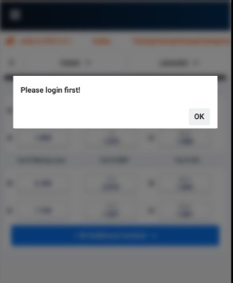
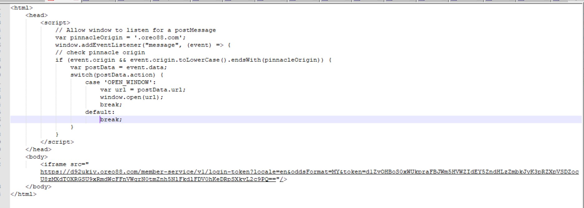
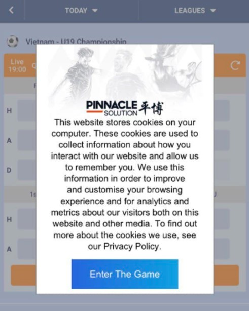
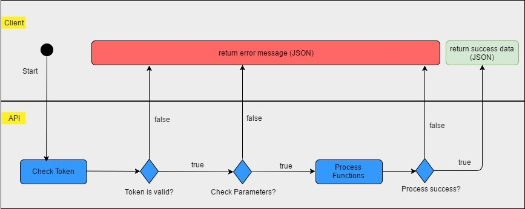

# Table Contents
- [Table Contents](#table-contents)
- [Transefer Wallet](#transefer-wallet)
    - [1. Purpose 目的](#1-purpose)
    - [2. Background 背景](#2-background)
        - [2.1. Authentication & API Requirements 认证和API要求](#21-authentication-api-requirements)
        - [2.2. Data Format 数据格式](#22-data-format)
        - [2.3. Data Time 日期时间](#23-data-time)
        - [2.4. Generate Token 产生令牌](#24-generate-token)
        - [2.5. Errors and Exceptions 错误和例外](#25-errors-and-exceptions)
        - [2.6. Getting started 如何开始](#26-getting-started)
        - [2.7. "Please login first" Solution "请先登录"解决方法](#27-please-login-first-solution)
    - [3. API Functions API功能](#3-api-functions-api)
        - [3.1.	FA001 – Login 登入](#31-fa001-login)
        - [3.2.	FA002 – Logout 登出](#32-fa002-logout)
        - [3.3. FA003 – LoginV2 登陆V2](#33-fa003-loginv2)
        - [3.4.	FP001 – Create User 创建用户](#34-fp001-create-user)
        - [3.5. FP003 – Get Player 获取用户](#35-fp003-get-player)
        - [3.6. FP004 – Get List Player 获取用户列表](#36-fp004-get-list-player)
        - [3.7. FP005 – Deposit 存款](#37-fp005-deposit)
        - [3.8.	FP006 – Withdraw 提款](#38-fp006-withdraw)
        - [3.9. FP007 – Change Status Member 更改用户状态](#39-fp007-change-status-member)
        - [3.10. FR001 – Wagers 投注](#310-fr001-wagers)
        - [3.11. FR002 – All Wagers – 所有投注](#311-fr002-all-wagers)
        - [3.12. FR003 – Win Loss Simple - 简易盈亏](#312-fr003-win-loss-simple)
        - [3.13. FR004 – Get My Bet – 获取我的投注](#313-fr004-get-my-bet)
        - [3.14. FR005 – Wager Feed – 投注资料](#314-fr005-wager-feed)
        - [3.15. FR006 – Announcement 公告](#315-fr006-announcement)
        - [3.16. FR007 – Transactions 交易](#316-fr007-transactions)
        - [3.17. FR008 – Check Status for Deposit/Withdraw 查询存取款状态](#317-fr008-check-status-for-deposit-withdraw)
        - [3.18. FR009 – Get Hot Event 获取热门赛事](#318-fr009-get-hot-event)
    - [4. Screens and Workflows 截图和工作流程](#4-screens-and-workflows)
    - [5. Appendix 附录](#5-appendix)
        - [5.1. Errors Table 错误表格](#51-errors-table)
        - [5.2. View 界面](#52-view)
        - [5.3. Tab 登入标签](#53-tab)
        - [5.4. Game Name 游戏名称](#54-gamename)
    - [6. Code Example](#6-code-example)
    - [7. References](#7-references)
  
# Transefer Wallet

## 1. Purpose  目的 <a name="1-purpose"></a>

I-White-label 3rd Party integration API to allow B2B customers to integrate sportsbook website to B2B customer website. BSB customer’s users will be able to access and place bet in sportsbook system from B2B customer’s websites without forcing user to register in sportsbook website.

I-外包合作第三方对接API能使B2B客户将体育对接到B2B客户的网站，B2B客户的用户在不需要在体育平台网站注册用户的情况上能够从B2B客户的网站拜访并在体育博彩系统进行投注。

-	Create player account 创建用户账户
-	Login player 用户登入
-	Logout player 用户登出
-	Adjust player balance调整用户余额
-	Get Player wagers 获取用户投注

## 2. Background  背景 <a name="2-background"></a>

### 2.1. Authentication & API Requirements 认证和API要求  <a name="21-authentication-api-requirements"></a>

1.	To be able to call API, B2B customer need to provide IPs to be whitelisted.
    为了能够呼唤API, B2B客户需要提供IP供平博技术团队列入白名单。
2.	All functional call API are passed authentication in HTTP Header:
    所有的功能调用API都通过HTTP Header中的认证:
    - token: `<token>`
    - userCode: `<agent code>`
3.	You need have 3 important items as below to generate:
    您需要产生3个重要的项目如下
    - Agent code (`agentCode`) 
    - Agent key (`agentKey`) 
    - Secret key (`secretKey`)

### 2.2. Data Format 数据格式 <a name="22-data-format"></a>

API supports only JSON format.
API 只支持JSON格式

**Note: List of  truncated currencies (x1000)**
1. Vietnam Dong (VND)
2. Indonesian Rupiahs (IDR)
3. Cambodia Riel (KHR)
4. Lao KIP (LAK)
5. Myanmar Krat (MMK)
6. Malagasy ariary (MGA)

Example: 100 IDR in system mean 100,000 IDR

### 2.3. Data Time 日期时间 <a name="23-data-time"></a>

All date will be in GMT-4 except `Timestamp`
除时间戳`Timestamp`以外，所有日期均为GMT-4Date format: yyyy-MM-dd
日期格式：年-月-日

Date Time format: yyyy-MM-dd HH:mm:ss. For example: 2017-04-01 07:00:00

日期时间格式：年-月-日 小时：分钟：秒钟。 例如： 2017-04-01 07:00:00

`Timestamp` (only use for generate token): A UNIX timestamp, also known as Epoch Time or POSIX timestamp, is a representation of a moment defined as the time that has elapsed since a reference known as the UNIX epoch: 1970-01-01 00:00:00 UTC (what is UTC). Using Java as an example, `System.currentTimeMillis()` returns just that, a UNIX timestamp in milliseconds.

时间戳（仅用于产生令牌）：UNIX时间戳，也称为“Epoch Time”或POSIX时间戳，定义为UNIX epoch是一个时间的表示已经过去的时间：1970-01-01 00:00:00 UTC（什么是UTC）。以Java为例，System.currentTimeMillis()返回一个UNIX时间戳（毫秒）。

Please use this code to get timestamp in java: `long timestamp = System.currentTimeMillis();`

请用这个令牌在java获取时间戳: `long timestamp = System.currentTimeMillis();`

For example: `1493366020081`
	例如：`1493366020081`

### 2.4. Generate Token 产生令牌 <a name="24-generate-token"></a>

Timestamp in milliseconds format (*A UNIX timestamp, also known as Epoch Time or POSIX timestamp*);  

时间戳，以毫秒为单位(*UNIX时间戳, 也称为Epoch Time或POSIX时间戳*)	

```java
String hashToken = md5(agentCode + timestamp + agentKey);
String tokenPayLoad = agentCode|timestamp|hashToken;
String token = encryptAES(secretKey, tokenPayLoad); 
```

*Sample code (java)  示例代码 (java)*

```java
import java.security.NoSuchAlgorithmException;  
import java.util.Base64;  
import java.util.concurrent.TimeUnit;  
import java.util.logging.Level;  
import java.util.logging.Logger;  
import javax.crypto.Cipher;  
import javax.crypto.spec.IvParameterSpec;  
import javax.crypto.spec.SecretKeySpec;  
import org.apache.commons.codec.digest.DigestUtils;  

private static final String ALGORITHM = "AES";  
private static final String INIT_VECTOR = "RandomInitVector";  
private static String generateToken(String agentCode, String agentKey, String secretKey)
                throws NoSuchAlgorithmException {    
    String sTimestamp = String.valueOf(System.currentTimeMillis());    
    String hashToken = DigestUtils.md5Hex(agentCode + sTimestamp + agentKey);    
    String tokenPayLoad = String.format("%s|%s|%s", agentCode, sTimestamp, hashToken);    
    String token = encryptAES(secretKey, tokenPayLoad);    
    return token;    
}    
  
private static String encryptAES(String secretKey, String tokenPayLoad) {  
    try {  
        SecretKeySpec secretKeySpec = new SecretKeySpec(secretKey.getBytes(), ALGORITHM);  
        IvParameterSpec iv = new IvParameterSpec(INIT_VECTOR.getBytes("UTF-8"));  
        Cipher cipher = Cipher.getInstance("AES/CBC/PKCS5PADDING");  
        cipher.init(Cipher.ENCRYPT_MODE, secretKeySpec, iv);  
        byte[] encrypted = cipher.doFinal(tokenPayLoad.getBytes());  
        return Base64.getEncoder().encodeToString(encrypted);  
    } catch (Exception ex) {  
        logger.log(Level.INFO, "An exceptionn occurred when encript key: \
                    {0}, plain text: {1}, exception {2}", 
                    new Object[]{secretKey, tokenPayLoad, ex.toString()});  
    }  
    return null;  
}  
```

*Sample code (C#)示例代码 (C#)* 

```csharp
using System;  
using System.Collections.Generic;  
using System.Linq;  
using System.Text;  
using System.Security.Cryptography;  
  
private static string INIT_VECTOR = "RandomInitVector";   
  
public string generateToken(string agentCode, string agentKey, string secretKey)  
{  
    string timeStamp = ((long)(DateTime.UtcNow - new DateTime(1970, 1, 1)).TotalMilliseconds).ToString();  
    string hashToken = md5Hex(agentCode + timeStamp + agentKey);  
    string tokenPayLoad = String.Format("{0}|{1}|{2}", agentCode, timeStamp, hashToken);  
    return encryptAES(secretKey, tokenPayLoad);  
}  
private string md5Hex(String data)  
{  
    MD5CryptoServiceProvider x = new MD5CryptoServiceProvider();  
    byte[] bs = System.Text.Encoding.UTF8.GetBytes(data);  
    bs = x.ComputeHash(bs);  
    StringBuilder s = new StringBuilder();  
    foreach (byte b in bs)  
    {  
        s.Append(b.ToString("x2").ToLower());  
    }  
  
  
    return s.ToString();  
}  
public string encryptAES(string secretKey, string tokenPayLoad)  
{  
    using (  
        var csp = new AesCryptoServiceProvider())  
    {  
        ICryptoTransform e = GetCryptoTransform(csp, true, secretKey);  
        byte[] inputBuffer = Encoding.UTF8.GetBytes(tokenPayLoad);  
        byte[] output = e.TransformFinalBlock(inputBuffer, 0, inputBuffer.Length);  
        string encrypted = Convert.ToBase64String(output);  
        return encrypted;  
    }  
}  
private ICryptoTransform GetCryptoTransform(AesCryptoServiceProvider csp, 
                bool encrypting, string secretKey)  {  
    csp.Mode = CipherMode.CBC;  
    csp.Padding = PaddingMode.PKCS7;  
    byte[] key = Encoding.UTF8.GetBytes(secretKey);  
  
    csp.IV = Encoding.UTF8.GetBytes(INIT_VECTOR);  
    csp.Key = key;  
    if (encrypting)  
    {  
        return csp.CreateEncryptor();  
    }  
    return csp.CreateDecryptor();  
}  
```

*Sample Code (PHP version 7.0 before) 示例代码（PHP 7.0版本以前）*
This sample code is suitable for PHP version from 7.0.x before.

```php
<?php  
class PHPCipher {    
        
        public function generateToken($agentCode, $agentKey, $secretKey)  
        {  
            $timestamp = time()*1000;  
            $hashToken = md5($agentCode. $timestamp . $agentKey);  
            $tokenPayLoad = $agentCode . '|' . $timestamp . '|' . $hashToken;  
            $token = $this->encryptAES($secretKey, $tokenPayLoad);  
              
            return $token;  
        }  
        private function encryptAES($secretKey, $tokenPayLoad)    
        {    
            $size = mcrypt_get_block_size(MCRYPT_RIJNDAEL_128, MCRYPT_MODE_CBC);    
            $td = mcrypt_module_open(MCRYPT_RIJNDAEL_128, '', MCRYPT_MODE_CBC, '');    
            $iv = "RandomInitVector";    
            mcrypt_generic_init($td, $secretKey, $iv);    
            $encrypt = mcrypt_generic($td, $this->pad($tokenPayLoad, $size));    
            mcrypt_generic_deinit($td);    
            mcrypt_module_close($td);    
            return base64_encode($encrypt);    
        }    
        
        private function pad($text, $blocksize)    
        {    
            $pad = $blocksize - (strlen($text) % $blocksize);    
            return $text . str_repeat(chr($pad), $pad);    
        }    
    }    
   
      
    $agentCode = "CO1AP1";  
    $agentKey = "RR3AaKBxGxLqEFpCXh0O3nJBsqRgDWA9nFU1SYEeLgmt123456";  
    $secretKey = "1234567890123456";   
      
        
    $cipher = new PHPCipher();    
        
    echo $cipher->generateToken($agentCode, $agentKey, $secretKey);    
  
  
?>
```

*Sample Code (PHP version 5.x, 6.x and 7.1 later) 示例代码（PHP 版本 5.x, 6.x and 7.1及更新版本）*

This sample code is suitable for almost PHP version from version 5.x to version 7.1.x later. You need active extension `php_openssl`

以下示例代码适用于PHP5.x到7.1.x版本以及更新版本。您需要用到活跃后缀`php_openssl`

```php
<?php  
  
class PHPCipher  
{  
      
    public function generateToken($agentCode, $agentKey, $secretKey)  
    {  
        $timestamp = time()*1000;    
        $hashToken = md5($agentCode. $timestamp . $agentKey);  
        $tokenPayLoad = $agentCode . '|' . $timestamp . '|' . $hashToken;  
        $token = $this->encryptAES($secretKey, $tokenPayLoad);  
  
        return $token;  
    }  
      
    private function encryptAES($secretKey, $tokenPayLoad)  
    {  
        $iv = "RandomInitVector";  
        $encrypt = openssl_encrypt($tokenPayLoad, "AES-128-CBC", 
                    $secretKey, OPENSSL_RAW_DATA, $iv);
        return base64_encode($encrypt);  
    }  
      
}  
  
$agentCode = "CO1AP1";  
$agentKey = "RR3AaKBxGxLqEFpCXh0O3nJBsqRgDWA9nFU1SYEeLgmt123456";  
$secretKey = "1234567890123456";  
  
$cipher = new PHPCipher();    
  
echo $cipher->generateToken($agentCode, $agentKey, $secretKey);    
?> 
```

### 2.5. Errors and Exceptions 错误和例外 <a name="25-errors-and-exceptions"></a>

Error response with known error.
已知错误的错误响应

```js
{  
    code: '108',  
    message: 'Agent invalid. Please contact partner to get agent code.'  
} 
```

Please see details at Error Table
请在错误表格中参看详细信息

Unexpected exception error format only including “trace”. Customer can send trace_code to IT Support Team for helping.
意外的异常错误格式只会包含 “追踪 trace”代码. 客户可以发送追踪代码trace_code给技术服务团队申请协助。

```js
{  
    trace: 'CO1AP1|VDyxg0Jj0KuYZpnrG7kEjYaVZDfieeDTa4Fhb+v1ZHjWoKY4a2t2PJNOX/A88\
        +vLLl2fD0ep1hK6cwmj0z0fEA==|28642330553954',  
} 
```

### 2.6. Getting started 如何开始 <a name="26-getting-started"></a>

**Step 1 – Sign up**
步骤1 – 注册

To get started you need to create an account and get agent code via agent site.
开始前，您需要创建一个帐户，并通过代理网站获取agent code。

**Step 2 – Receive agent key**
步骤2 – 获得agentKey

You need send agentCode (create at step 1) to our Partner Support Center to get agentKey and secretKey
您需要将agentCode（步骤1创建）发给我们代理服务中心来获取agentKey 和secretKey

Please note that your request to access API the IP must in our white list.
请注意：IP
需要先列入白名单，您才能够申请访问

**Step 3 – Generate token (refer 2.4)**
步骤 3 – 产生令牌（参考 2.4）

**Step 4 – Call API service**
步骤4 – 呼唤API服务

For each service call, you need to pass token verification and the appropriate parameters
对每个服务呼唤，您需要通过令牌验证以及的合适的参数

### 2.7. "Please login first" Solution "请先登录"解决方法 <a name="27-please-login-first-solution"></a>

There are several enhancements to Intelligent Tracking Prevention (ITP) in iOS and iPadOS 13.4 and Safari 13.1 on macOS, which causes our B2B embedded iFrame always show a pop-up "Please login first" when the user wants to place bets. 

Technically, with our current behavior iFrame will use cookies to authenticate users, but with those enhancements - especially "Full Third-Party Cookie Blocking", there is no cookie for us to do the authentication.

It means that our Pinnacle iFrame is always a Third-Party Cookie, but now because of the ITP, it has fully blocked the Third-Party Cookie.

在 IOS 和 iPadOS 13.4 以及 macOS 上的 Safari 13.1 对智能跟踪预防 (ITP) 进行了多项增强，这导致我们的 B2B 嵌入式 iFrame 在用户想要下注时始终显示弹出视窗“请先登录”。

在技术层面上，根据我们当前的系统行为，iFrame 是使用 Cookie 来验证用户身份，但是有了上述这些增强功能 — 尤其是“完全屏蔽第三方Cookie”，我司便没有 Cookie 来进行用户身份验证了。

这意味着我们的 Pinnacle iFrame 始终为第三方 Cookie，但现在因为 ITP，它已经完全屏蔽了第三方 Cookie。



Solution: 
It will show a pop-up when players access the iFrame, and they will need to accept the cookies in order to access the iFrame.

解决方案：
当玩家访问 iFrame 时，它将显示弹出视窗，他们需要接受 cookie 才能访问 iFrame。

Fixed script 
固定脚本：

```javascript
// Allow window to listen for a postMessage
var pinnacleOrigin = '.example.com'; // Contact Pinnacle support to get domain info
window.addEventListener("message", (event) => {
	// check pinnacle origin
	if (event.origin && event.origin.toLowerCase().endsWith(pinnacleOrigin)) {
		var postData = event.data;
		switch (postData.action) {
			case 'OPEN_WINDOW':
				var url = postData.url;
				window.open(url);
				break;
			default:
				break;
		}
	}
});
```



After the script is added, please provide a test account with the URL for us to check.
添加脚本后，请提供 URL和测试账号供我方检查。

After the solution is enabled, the iFrame will display a pop-up “Enter The Game”, and members need to allow the 3rd party cookies to enter the game.
启用解决方案后，iFrame 会显示弹出视窗 “进入游戏” ，玩家需要允许第三方 cookie 才能进入游戏。



## 3. API Functions API功能 <a name="3-api-functions-api"></a>

### 3.1. FA001 – Login 登入 <a name="31-fa001-login"></a>

This API is used to generate a URL without the player needing to login.
这个服务是让用户无需登录也能产生URL

Endpoint 端点

| Name  | Value  | Description  |
| --- | --- | --- |
| URL  | `/player/login`  |   |
| Method  | `GET`/`POST`  | For POST method, it is recommended to send parameters as an JSON object in the request body  |

| Name | Value | Validation | Description |
| --- | --- | --- | --- |
| `userCode`  | String <br/>(required 必需项) | | This is agent code that you get at step 2. <br/>E.g: CO1AP1 此为在第二步骤获取的代理编号，例如，CO1AP1 |
| `token` | String<br/>(required 必需项) | Token is available in 15 minutes since it was created <br/>令牌在创建之后的15分钟内有效 | |

**Parameters 参数**

| Name | Value | Validation | Description |
| --- | --- | --- | --- |
| `userCode` | String<br/>(required 必需项) | | This is user code / loginID of player. E.g: *PA10000000* 此为玩家登录名/用户名，例如*PA10000000* |
| `locale` | String <br/>(optional 非必需项) | List supported locales based on available brand’s languages. | Appendix Locale (Language) |
| `oddsFormat` | String <br/>(optional 非必需项) | List supported oddsFormat is provided by view at Appendix View | Appendix Odds Format |
| `desktopView` | Boolean <br/>(optional 非必需项) | `true`/`false` *(Default: false)* <br/> Only applicable to Asian view <br/> 仅限用于亚洲界面| If true then desktop view be used when their players use mobile device Otherwise, the appropriate view must be displayed based on the device (desktop or mobile). |
| `view` | String <br/>(optional 非必需项) | Default: COMPACT | Appendix View  <br/> Once the parameter is set, the view would be the default view in the iFrame. 该参数可设置并更改默认界面 |
| `target` | String <br/>(optional 非必需项) | `LIVE`/`HIGHLIGHTS` *(Default: LIVE)* <br/>Only applicable mobile Euro view. 仅限用于手机欧洲界面。 | Your customers will be directed to the corresponding tab page. 玩家将被定向到相对应的标签页。 |

*Format URL login  URL登录格式*

```
<host>/member/<locale>/sports?oddsFormat=HK&token=<token>
```

Example: 
http://whitelabelapidomain.com/member/en/sports?oddsFormat=HK&token=TkIxS3pJc2RwdituRmNXam1NVGk0ZlhsZ0lrV285Y2JncFAvVXN2V2dsNVAvNHdXejFadHQ1UTZoeFB6c201cXQ4dXc5NC8vL0pvNHhDQUN4bng0T2c9PQ==

*Note: This token is generated by the Pinbo system to allow users to log in to our system. This is not a token generated by a third party.*
*注意 : 这个 令牌 是由 平博 系统产生让 用 户 登入我 们的系统。这个不是第三方产生的 令牌。*

*Sample code (java) - See HttpUtils class at Appendix*
*示例代码（java）– 请参阅附录里的 HttpUtils class*

```java
import java.io.IOException;  
import java.util.HashMap;  
import java.util.Map;  
private static void getTokenLogin() throws IOException {  
    Map params = new HashMap(); 
    params.put("userCode", "PA10000000"); 
    params.put("locale", "zh-cn"); 
    params.put("oddsFormat", "HK");
    Map headers = new HashMap();  
    headers.put("userCode", "CO1AP1");  
    headers.put("token", "gvbLZb70DhMNXMLw3egvktPT3sfDWnDC5QI97MXHqK9FCFO1n6oepaXQivCIVpsDlth/jbR/qgUcpi2wHc62Tw==");  
      
    String url = "http://apidomain.com/b2b/player/login";  
    String result = HttpUtils.post(url, "", params, headers);  
    System.out.println(result);  
}  
```

*Sample code (C#)  示例代码（C#）*

```csharp
using System;  
using System.Net.Http;  
using System.Collections.Generic;  
using System.Threading.Tasks;  
  
namespace Login  
{  
    class Program  
    {  
        static void Main(string[] args)  
        {  
            Dictionary<string, string> parameters = new Dictionary<string, string>();  
            parameters.Add("userCode", "QAT0101.05");  
            parameters.Add("locale", "zh-cn");  
            parameters.Add("oddsFormat", "HK");  
  
            Dictionary<string, string> headers = new Dictionary<string, string>();  
            headers.Add("userCode","QAT0101");  
            headers.Add("token","LrSnxY89VuOx05LD6goEQ5fcnWzKT36mwhdJ73A86WJO66wzGmJN9YGDgR8Ac9qLWCTmpaOtZUgv2\
                r714TiZGQ==");  
  
            Console.WriteLine(HttpUtils.PostRequest("https://api.pinnaclesolution.com/b2b/player/login",\
                 parameters, headers).Result);  
            Console.ReadKey();  
        }  
    }  

    class HttpUtils  {  
        public async static Task<string> PostRequest(String url, Dictionary<string, string> 
            parameters, Dictionary<string, string> headers)  {  
            HttpClient client = new HttpClient();  
            foreach(var item in headers) {   
                client.DefaultRequestHeaders.Add(item.Key, item.Value);  
            }  
              
            var content = new FormUrlEncodedContent(parameters);  
            var response = await client.PostAsync(url + "?" + content.ReadAsStringAsync().Result, null);  
            return await response.Content.R     eadAsStringAsync();  
        }  

        public async static Task<string> GetRequest(String url, Dictionary<string, string> 
            parameters, Dictionary<string, string> headers)    {    
            HttpClient client = new HttpClient();    
            foreach(var item in headers){ client.DefaultRequestHeaders.Add(item.Key, item.Value);}    
              
            var content = new FormUrlEncodedContent(parameters);    
            var response = await client.GetAsync(url + "?" + content.ReadAsStringAsync().Result);    
            return await response.Content.ReadAsStringAsync();    
        }  
    }  
}  
```

*Response 反应*

Result is URL to login System. Then we use this url to open new popup in browser. This url will auto login the system. 
结果是登录系统的URL。然后我们使用这个URL在浏览器中打开新的弹出窗口。这个网址会自动登录系统。

```js
{   
	loginUrl: 'http://whitelabelapidomain.com/member/en?oddsFormat=HK&token=xyz',   
	userCode: 'PA10000000', 
	loginId: 'PA1000',                 
	token: 'thisislogintokengeneratetologin',        
	updatedDate: 1459312108353                   
}
```

*Extension扩充*

In Mobile version we have support “Back” icon    to redirect to [custom URL]. Here [custom URL] is the url that you add more “externalUrl” param to Login link responded. 
在移动版，我们有“返回”的图标 重定向[定制 URL]. 这里的[定制 URL]是你多加的“externalURL”参数给登陆链接回应。

For example: http://whitelabelapidomain.com/en/sports?token=eGRDMFRQZDZQYlhIelBFdXZ2UVN5Nm9MNHlkNThVc0JiRm5SN2hMcVE3dEhHZm00ZnFDbmVMYzB5OTVFYW1NV0NZN0F2c0tqZXFjSU9EdjJhN0tiWXc9PQ==&externalUrl=http://google.com

When you click on “Back” icon, app will send redirect to google.com page 
当你点击“返回”图标，应用程序将发送重定向到google.com页面

*Note: this feature is only available on Mobile version*
*注意：此功能只有在移动版本上有*

### 3.2. FA002 – Logout 登出 <a name="32-fa002-logout"></a>

If you need to logout from system by userCode. You need call this function.
如果你需要通过userCode登出系统。你需要调用这个函数。

**Endpoint 端点**

| Name | Value | Description |
| --- | --- | --- |
| URL | `/player/logout` | |
| Method | `GET`/`POST` | For POST method, it is recommended to send parameters as an JSON object in the request body |

**Parameters 参数**

| Name | Type | Value | Validation | Description |
| --- | --- | --- | --- | --- |
| `userCode` | Header | String <br/>(required 必需项) | | This is agent code that you get at step 2. <br/>E.g: CO1AP1 此为在第二步骤获取的代理编号，例如，CO1AP1 |
| `token` | Header | String <br/>(optional 非必需项) | Token is available in 15 minutes since it was created  <br/>令牌在创建之后的15分钟内有效 | |
| `userCode` | Query | String <br/>(required 必需项) | | This is user code / loginID of player . <br/>E.g: `PA10000000` 此为玩家登录名/用户名，例如`PA10000000` |

*Sample code (java) - See HttpUtils class at Appendix*
*示例代码（java）– 请参阅附录里的 HttpUtils class*	

```java
import java.io.IOException;  
import java.util.HashMap;  
import java.util.Map;  
private static void doLogout() throws IOException {  
    Map params = new HashMap();  
    params.put("userCode", "PA10000000");  
    Map headers = new HashMap();  
    headers.put("userCode", "CO1AP1");  
    headers.put("token", "gvbLZb70DhMNXMLw3egvktPT3sfDWnDC5QI97MXHqK9FCFO1n6oepaXQivCIVpsDlth/\
        jbR/qgUcpi2wHc62Tw==");
    String url = "http://apidomain.com/b2b/player/logout";  
    String result = HttpUtils.post(url, "", params, headers);  
    System.out.println(result);  
}
```

*Sample code (C#)  示例代码（C#）*

```csharp
using System;  
using System.Net.Http;  
using System.Collections.Generic;  
using System.Threading.Tasks;  
  
namespace Logout  
{  
    class Program  
    {  
        static void Main(string[] args)  
        {  
            Dictionary<string, string> parameters = new Dictionary<string, string>();  
            parameters.Add("userCode", "PA10000000");  
  
            Dictionary<string, string> headers = new Dictionary<string, string>();  
            headers.Add("userCode","CO1AP1");  
            headers.Add("token","DIwYQJZIYiosWrbXQe+TFdyMk6POZvbcM1KjxxQObZEn0+efzoMCb3i\
                +PWr1ZFuj0UciR8w+qqo1M2hJ965Y9w==");  
  
            Console.WriteLine(HttpUtils.PostRequest("http://apidomain.com/b2b/player/logout", 
                parameters, headers).Result);  
            Console.ReadKey();  
        }  
    }  
} 
```

*Response反应*

```js
{  
	"status": "successful"  
}  
```

### 3.3. FA003 – LoginV2 登陆V2 <a name="33-fa003-loginv2"></a>

This API is used to create a new user and generate a URL that would allow the player to access the website without needing to login. This API is different from FA001 in the case when the player doesn't exist in the system, a new user will be created.

这项服务是用以创建新用户并通过产生一个URL允许用户无需登录也能访问网站。 这个服务跟FA001不同的是如果用户在系统里不存在，将会创建新用户

**Endpoint 端点**

| Name | Value | Description |
| --- | --- | --- |
| URL | `/player/loginV2 ` | |
| Method | `GET`/`POST` | For POST method, it is recommended to send parameters as an JSON object in the request body |

**Parameters 参数**

| Name | Type | Value | Validation | Description |
| --- | --- | --- | --- | --- |
| `userCode` | Header | String <br/>(required 必需项) | | This is agent code that you get at step 2. <br/>E.g: CO1AP1 此为在第二步骤获取的代理编号，例如，CO1AP1 |
| `token` | Header | String<br/> (required 必需项) | Token is available in 15 minutes since it was created<br/>令牌在创建之后的15分钟内有效 | |
| `loginId`  | Query | String <br/>(required 必需项)  | If loginId has not existed in system, it will validate and create new player based on this loginId.<br/>Rule validate loginId: <br/>Must be between 6 and 50 alphanumeric characters. | This is user code / loginID of player. <br/>此为玩家登录名/用户名，例如 |
| `locale` | Query | String <br/>(optional 非必需项) | List supported locales based on available brand’s languages. | Appendix Locale (Language) |
| `sport` | Query | String <br/>(optional 非必需项) | List Sport supported.<br/>**Notes:**<br/>If you only want to show only e-sports in the Iframe, you need to contact us to enable setting and the sport parameter must be "e-sports".<br/>若您想在iframe中只显示电子竞技，需与我们联系以启用设置，并且需将sport参数设置为”e-sports” | Appendix Sport |
| `oddsFormat` | Query | String<br/>(optional 非必需项) | List supported oddsFormat is provided by view at Appendix View | Appendix Odds Format |
| `desktopView` | Query | Boolean<br/>(optional 非必需项) | `true`/`false` *(Default: false)* <br/> Only applicable to Asian view <br/> 仅限用于亚洲界面 | If true then desktop view be used when their players use mobile device  Otherwise, the appropriate view must be displayed based on the device (desktop or mobile). |
| `view` | Query | String<br/>(optional 非必需项) | Default: COMPACT | Appendix View <br/> Once the parameter is set, the view would be the default view in the iFrame. 该参数可设置并更改默认界面 |
| `eventId` | Query | Number<br/>(optional 非必需项) | Event ID can be obtained by the Get Hot Event API. event Id 可以通过热门赛事 API获取。 | Your customers will be directed to the corresponding event page. 玩家将被定向到相对应的赛事页面。 |
| `parentUrl` | Query | String <br/>(optional 非必需项) | Client's domain which will be used for live streaming of esports hub | This parameter only supporting for Esports-Hub 该参数仅支持在Esports-Hub |
| `tab` | Query | String <br/>(optional 非必需项) | | Appendix Tab <br/> This parameter only supporting for Esports-Hub 该参数仅支持在Esports-Hub |
| `gameName` | Query | String <br/>(optional 非必需项) | | Appendix Game Name <br/> This parameter only supporting for Esports-Hub 该参数仅支持在Esports-Hub |
| `leagueId` | Query | Number<br/>(optional 非必需项) | League ID can be obtained by the Get Hot Event API. league Id 可以通过热门赛事 API获取。 | Customers to be redirected to the corresponding League page. 玩家将被定向到相对应的联赛页面。 |
| `target` | Query | String <br/>(optional 非必需项) | `LIVE`/`HIGHLIGHTS` *(Default: LIVE)* <br/>Only applicable mobile Euro view. 仅限用于手机欧洲界面。 | Your customers will be directed to the corresponding tab page. 玩家将被定向到相对应的标签页。 |

*Workflow工作流程*
To be added
以后添加

*Format URL login URL登陆格式*

```
<host>/member-service/v1/login-token?locale=<en>&sport=<sport>&oddsFormat=<oddsFormat>&token=<token>
```

Example: 
http://whitelabelapidomain.com/member-service/v1/login-token?locale=en&sport=soccer&oddsFormat=HK&token=YkZXSFl5S0VsUElrQzRlRS9ZRERsbDN3dktnb2dnSE1tcTZ1VTEvVnFldTJkVTcyWklJeVVRSk1xY3dpM2VWVXFYY3IxMzRpWGNBWllsakV2Wk1JZ0E9PQ==

*Note: This token is generated by the Pinbo system to allow users to log in to our system. This is not a token generated by a third party.*

*注意: 这个 令牌 是由 平博 系统产生让 用 户 登入我 们的系统。这个不是第三方产生的 令牌。*

*Sample code (java) - See HttpUtils class at Appendix*
*示例代码（java）– 请参阅附录里的 HttpUtils class*

```java
import java.io.IOException;  
import java.util.HashMap;  
import java.util.Map;  
private static void getTokenLogin() throws IOException {  
    Map params = new HashMap();  
    params.put("loginId", "PA1002"); 
    params.put("locale", "zh-cn"); 
    params.put("sport", "tennis"); 
    Map headers = new HashMap();  
    headers.put("userCode", "CO1AP1");  
    headers.put("token", "gvbLZb70DhMNXMLw3egvktPT3sfDWnDC5QI97MXHqK9FCFO1n6oepa\
        XQivCIVpsDlth/jbR/qgUcpi2wHc62Tw==");  
    String url = "http://apidomain.com/b2b/player/loginV2";  
    String result = HttpUtils.post(url, "", params, headers);  
    System.out.println(result);  
}  
```

*Sample code (C#)  示例代码（C#）*

```csharp
using System;  
using System.Net.Http;  
using System.Collections.Generic;  
using System.Threading.Tasks;  
  
namespace LoginV2  
{  
    class Program  
    {  
        static void Main(string[] args)  
        {  
            Dictionary<string, string> parameters = new Dictionary<string, string>();  
            parameters.Add("loginId", "PA1002");   
            parameters.Add("locale", "zh-cn");   
            parameters.Add("sport", "tennis");   
  
            Dictionary<string, string> headers = new Dictionary<string, string>();  
            headers.Add("userCode","CO1AP1");  
            headers.Add("token","DIwYQJZIYiosWrbXQe+TFdyMk6POZvbcM1KjxxQObZEn0+efzoMCb3i\
                +PWr1ZFuj0UciR8w+qqo1M2hJ965Y9w==");  
  
            Console.WriteLine(HttpUtils.PostRequest("http://apidomain.com/b2b/player/loginV2", 
                parameters, headers).Result);  
            Console.ReadKey();  
        }  
    }  
}  
```

*Response 反应*

Result is URL to login System. Then we use this url to open new popup in browser. This url will auto login Pinnacle Solution system. 

然后我们用这个URL在浏览器中打开新的弹出视窗。

```js
{   
  loginUrl: 'http://whitelabelapidomain.com/member-service/v1/login-token\
        ?locale=zh-cn&sport=tennis&token=YkZXSFl5S0VsUElrQzRlRS9ZRERsbDN3dktnb2dnSE1tcTZ1VTEvVnFldTJkV\
        TcyWklJeVVRSk1xY3dpM2VWVXFYY3IxMzRpWGNBWllsakV2Wk1JZ0E9PQ==,   
  userCode: 'PA10000001', 
  loginId: 'PA1002',                 
  token: 'YkZXSFl5S0VsUElrQzRlRS9ZRERsbDN3dktnb2dnSE1tcTZ1VTEvVnFldTJkVTcyWklJeVVRSk1xY3d\
    pM2VWVXFYY3IxMzRpWGNBWllsakV2Wk1JZ0E9PQ==',        
  updatedDate: '2017-05-26 05:37:16'                   
}   
```
_Usage Limits 使用限制_

Usage is limited to a maximum of 20 requests per 5 seconds.

最大使用限制为每 5 秒20 个请求。

*Extension 扩充*

In Mobile version we have support “Back” icon to redirect to [custom URL]. Here [custom URL] is the url that you add more “externalUrl” param to Login link responded. 

在移动版，我们有“返回”的图标 重定向[定制 URL]. 这里的[定制 URL]是你多加的“externalURL”参数给登陆链接回应。

For example:

http://whitelabelapidomain.com/member-service/v1/login-token?locale=en&token=eGRDMFRQZDZQYlhIelBFdXZ2UVN5NmZNWXE4RFlnUm1vS1pFeVFnVFV4MEpWYkZ5SlczM0ZmZTlFNUhlTytRYTdXeUNmUTN2ak5iVXpQbTNLVWpCUkE9PQ==&externalUrl=http://google.com 

When you click on “Back” icon, app will send redirect to google.com page 

当你点击“返回”图标，应用程序将发送重定向到google.com页面

**Note**: this feature has only on Mobile version

注意：此功能只有在移动版本上有

### 3.4. FP001 – Create User 创建用户 <a name="34-fp001-create-user"></a>

This service is used to sign up a player

这个服务是用来注册用户

**Endpoint 端点**

| Name | Value | Description  |
| --- | --- | --- |
| URL | `/player/create` | |
| Method | `GET`/`POST` | For POST method, it is recommended to send parameters as an JSON object in the request body |

**Parameters 参数**

| Name  | Type | Value  | Validation  | Description  |
| --- | --- | --- | --- | --- |
| `userCode` | Header | String<br/> (required 必需项)  |  | This is agent code that you get at step 2. E.g: `CO1AP1` <br/><br/>此为在第二步骤获取的代理编号，例如，`CO1AP1` |
| `token` | Header | String (required 必需项) | Token is available in 15 minutes since it was created 令牌在创建之后的15分钟内有效 |  |
| `agentCode` | Query | String<br/>  (optional 非必需项) |  | Agent code downline that new created-player will be belong to. If no agent code provided, player will be created direct under agent code calling this API.  <br/>E.g: `CO1AP100` <br/><br/>新建玩家账户所属的代理编号。如果没有提供代理编号，那么玩家用户会直接创建在调用此API的代理账户之下，<br/>例如：`CO1AP100` |
| `loginId` | Query | String<br/> (optional 非必需项) | If you input loginId, system will validate loginId and response error if it exist in system. | Rule validate loginId:  Must be between 6 and 50 alphanumeric characters. |

*Sample code (java) - See HttpUtils class at Appendix*
*示例代码（HttpU– 请参阅附录里的 HttpUtils class*

```java
private static void createNewUser() throws IOException {  
    Map params = new HashMap();  
//      params.put("agentCode", "CO1AP100");   //optional parameter  
//      params.put("loginId", "PA10000001");   //optional parameter  
    Map headers = new HashMap();  
    headers.put("userCode", "CO1AP1");  
    headers.put("token", "gvbLZb70DhMNXMLw3egvktPT3sfDWnDC5QI97MXH\
        qK9FCFO1n6oepaXQivCIVpsDlth/jbR/qgUcpi2wHc62Tw==");  
      
    String url = "http://apidomain.com/b2b/player/create";  
    String result = HttpUtils.post(url, "", params, headers);  
    System.out.println(result);  
}  
```

*Sample code (C#)  示例代码（C#）*

```csharp
using System;  
using System.Net.Http;  
using System.Collections.Generic;  
using System.Threading.Tasks;  
  
namespace CreateUser  
{  
    class Program  
    {  
        static void Main(string[] args)  
        {  
            Dictionary<string, string> parameters = new Dictionary<string, string>();  
             
            Dictionary<string, string> headers = new Dictionary<string, string>();  
            headers.Add("userCode","CO1AP1");  
            headers.Add("token","DIwYQJZIYiosWrbXQe+TFdyMk6POZvbcM1KjxxQOb\
                ZEn0+efzoMCb3i+PWr1ZFuj0UciR8w+qqo1M2hJ965Y9w==");  
  
            Console.WriteLine(HttpUtils.PostRequest("http://apidomain.com/b2b/player/create", 
                    parameters, headers).Result);  
            Console.ReadKey();  
        }  
    }  
}  
```

*Response 反应*

```js
{   
  userCode: 'PA10000000',    // String [successful, fail]  
  loginId: 'PA1000',    
}   
```
_Usage Limits 使用限制_

Usage is limited to a maximum of 10 requests per 5 seconds.

最大使用限制为每 5 秒10 个请求。

### 3.5. FP003 – Get Player 获取用户 <a name="35-fp003-get-player"></a>

Get player information. 

获取用户资料

| Name | Value | Description |
| --- | --- | --- |
| URL | `/player/info` | |
| Method | `GET` | |

**Parameters 参数**

| Name  | Type | Value  | Validation  | Description  |
| ---  | --- | ---  | ---  | ---  |
| `userCode`  | Header | String  (required 必需项)  |  | This is agent code that you get at step 2. E.g: CO1AP1 此为在第二步骤获取的代理编号，例如，CO1AP1 |
| `token` | Header | String (required 必需项) | Token is available in 15 minutes since it was created 令牌在创建之后的15分钟内有效 |  |
| `userCode` | Query | String (required 必需项)  |  | This is user code / loginID of player. <br/>E.g: `PA10000000` <br/>此为玩家登录名/用户名，<br/>例如`PA10000000` |
|  |

*Sample code (java) - See HttpUtils class at Appendix*
*示例代码（java）– 请参阅附录里的 HttpUtils class*

```java
import java.io.IOException;  
import java.util.HashMap;  
import java.util.Map;  
  
private static void getPlayer() throws IOException {  
    Map params = new HashMap();  
    params.put("userCode", "PA10000000");  
    Map headers = new HashMap();  
    headers.put("userCode", "CO1AP1");  
    headers.put("token", "gvbLZb70DhMNXMLw3egvktPT3sfDWnDC5QI97MXHqK9FCFO1n6oepaXQivCIVpsDlth/jbR\
        /qgUcpi2wHc62Tw==");  
        
    String url = "http://apidomain.com/b2b/player/info";  
    String result = HttpUtils.get(url, "", params, headers);  
    System.out.println(result);  
}  
```

*Sample code (C#)  示例代码（C#）*

```csharp
using System;  
using System.Net.Http;  
using System.Collections.Generic;  
using System.Threading.Tasks;  
  
namespace GetPlayer  
{  
    class Program  
    {  
        static void Main(string[] args)  
        {  
            Dictionary<string, string> parameters = new Dictionary<string, string>();  
            parameters.Add("userCode", " PA10000000");   
  
            Dictionary<string, string> headers = new Dictionary<string, string>();  
            headers.Add("userCode"," CO1AP1");  
            headers.Add("token","UFizq11OTAHxGdaCkzxd1rymMxvIxc8tr3I5oLo3Z5jyh77EpddNrcwHO\
                +omwBnyl1uNrR+xF2+Hyqbw+8eOFA==");  
  
            Console.WriteLine(HttpUtils.GetRequest("http://apidomain.com/b2b /player/info",
                parameters, headers).Result);  
            Console.ReadKey();  
        }  
    }  
} 
```

*Response 反应*

```js
{  
  "userCode": "PA10000000",  
  "loginId": "PA1000",  
  "firstName": "",  
  "lastName": "",  
  "status": "ACTIVE", // (User Status)       
  "availableBalance": 0,  
  "outstanding": 0,  
  "createdDate": 2017-04-23 22:24:07,  
  "createdBy": "B2B"  
}  
```

### 3.6. FP004 – Get List Player 获取用户列表 <a name="36-fp004-get-list-player"></a>

Get list player information. 

获取用户列表信息

**Endpoint 端点**

| Name | Value | Description  |
| --- | --- | ---  |
| URL | `/list-player/info` | |
| Method | `GET` | |


**Parameters 参数**

| Name  | Type | Value  | Validation  | Description  |
| ---  | --- | ---  | ---  | ---  |
| `userCode`  | Header | String (required 必需项)  |  | This is agent code that you get at step 2. <br/>E.g: `CO1AP1` <br/>此为在第二步骤获取的代理编号，<br/>例如，`CO1AP1` |
| `token` | Header | String (required 必需项) | Token is available in 15 minutes since it was created<br/> 令牌在创建之后的15分钟内有效 |  |

*Sample code (java) - See HttpUtils class at Appendix*
*示例代码（java）– 请参阅附录里的 HttpUtils class*

```java
private static void getPlayer() throws IOException {  
	Map params = new HashMap();  
	Map headers = new HashMap();  
	headers.put("userCode", "CO1AP1");  
	headers.put("token", "gvbLZb70DhMNXMLw3egvktPT3sfDWnDC5QI97MXHqK9FCFO1n6oepaXQivCIVpsDlth\
            /jbR/qgUcpi2wHc62Tw==");  
		  
	String url = "http://apidomain.com/b2b/list-player/info";  
	String result = HttpUtils.get(url, "", params, headers);  
	System.out.println(result);  
}  
```

*Sample code (C#)  示例代码（C#）*

```csharp
using System;  
using System.Net.Http;  
using System.Collections.Generic;  
using System.Threading.Tasks;  
  
namespace GetListPlayer  
{  
    class Program  
    {  
        static void Main(string[] args)  
        {  
            Dictionary<string, string> parameters = new Dictionary<string, string>();  
  
            Dictionary<string, string> headers = new Dictionary<string, string>();  
            headers.Add("userCode","CO1AP1");  
            headers.Add("token","DIwYQJZIYiosWrbXQe+TFdyMk6POZvbcM1KjxxQObZEn0+efzoMCb3i\
                    +PWr1ZFuj0UciR8w+qqo1M2hJ965Y9w==");  
  
            Console.WriteLine(HttpUtils.GetRequest("http://apidomain.com/b2b/list-player/info", 
                    parameters, headers).Result);  
            Console.ReadKey();  
        }  
    }  
}
```

*Response 反应*

```js
[{  
  "userCode": "PA10000000",
  "loginId": "PA1000",  
  "firstName": "",  
  "lastName": "",  
  "status": "ACTIVE", // (User Status)       
  "availableBalance": 0,  
  "outstanding": 0,  
  "createdDate": 2017-04-23 22:24:07,  
  "createdBy": "B2B"  
}]  
```

### 3.7. FP005 – Deposit 存款 <a name="37-fp005-deposit"></a>

**Endpoint**

| Name  | Value  | Description   |
| ---  | ---  | ---  |
| URL  | `/player/deposit`  |   |
| Method  | `GET`/`POST` | For POST method, it is recommended to send parameters as an JSON object in the request body  |

**Parameters 参数**

| Name  | Type | Value  | Validation  | Description  |
| ---  | --- | ---  | ---  | ---  |
| `userCode`  | Header | String  (required 必需项)  |  | This is agent code that you get at step 2. E.g: CO1AP1 此为在第二步骤获取的代理编号，例如，CO1AP1 |
| `token` | Header | String (required 必需项) | Token is available in 15 minutes since it was created 令牌在创建之后的15分钟内有效 |  |
| `userCode`  | Query | String (required 必需项)   |   | This is user code / loginID of player. E.g: `PA10000000` 此为玩家登录名/用户名，例如`PA10000000` |
| `amount`  | Query | Decimal(10, 2) (required 必需项)  | Value  > 0  |   |
| `transactionId` | Query | String(50) (optional 非必需项) | Value > 0 | transaction Id you can use to check transaction status and it's unique 用于检查交易状态的交易ID |

Sample code (java) - See HttpUtils class at Appendix
示例代码（java）– 请参阅附录里的 HttpUtils class

```java
import java.io.IOException;  
import java.util.HashMap;  
import java.util.Map;  
  
private static void deposit() throws IOException {  
    Map params = new HashMap();  
    params.put("userCode", "PA10000000");  
    params.put("amount", 10);  
    Map headers = new HashMap();  
    headers.put("userCode", "CO1AP1");  
    headers.put("token", "gvbLZb70DhMNXMLw3egvktPT3sfDWnDC5QI97MXHqK9FCFO1n6oepaXQivCIVpsDlth/\
            jbR/qgUcpi2wHc62Tw==");  
          
    String url = "http://apidomain.com/b2b/player/deposit";  
    String result = HttpUtils.post(url, "", params, headers);  
    System.out.println(result);  
}  
```

*Sample code (C#)  示例代码（C#）*

```csharp
using System;  
using System.Net.Http;  
using System.Collections.Generic;  
using System.Threading.Tasks;  
  
namespace Deposit  
{  
    class Program  
    {  
        static void Main(string[] args)  
        {  
            Dictionary<string, string> parameters = new Dictionary<string, string>();  
            parameters.Add("userCode", "PA10000000");   
            parameters.Add("amount", "10");   
  
            Dictionary<string, string> headers = new Dictionary<string, string>();  
            headers.Add("userCode","CO1AP1");  
            headers.Add("token","DIwYQJZIYiosWrbXQe+TFdyMk6POZvbcM1KjxxQObZEn0+efzoMCb3i\
                    +PWr1ZFuj0UciR8w+qqo1M2hJ965Y9w==");  
  
            Console.WriteLine(HttpUtils.PostRequest("http://apidomain.com/b2b/player/deposit", 
                    parameters, headers).Result);  
            Console.ReadKey();  
        }  
    }  
}  
```

*Response 反应*

```js
{   
  'userCode': 'PA10000000',     // string   
  'loginId': 'PA1000',     // string   
  'availableBalance': 1010.00,   // decimal(after deposit)   
  'amount': 10.00      // decimal   
}
```

### 3.8. FP006 – Withdraw 提款 <a name="38-fp006-withdraw"></a>

Withdraw for player. 

用户提款

Endpoint

| Name  | Value  | Description   |
| ---  | ---  | ---   |
| URL  | `/player/withdraw`  |   |
| Method  | `GET`/`POST` | For POST method, it is recommended to send parameters as an JSON object in the request body |


Headers 头文件

| Name  | Value  | Validation  | Description  |
| ---  | ---  | ---  | ---  |
| userCode  | String (required 必需项)  |  | This is agent code that you get at step 2. E.g: CO1AP1 此为在第二步骤获取的代理编号，例如，CO1AP1 |
| token | String (required 必需项) | Token is available in 15 minutes since it was created 令牌在创建之后的15分钟内有效 |  |
| userCode  | String (required必需项) |  | This is user code / loginID of player. E.g: PA10000000 此为玩家登录名/用户名，例如PA10000000 |
| amount  | Decimal(10, 2) (required必需项)  | Value  > 0  |   |
| transactionId | String(50) (optional非必需项) | Value > 0 | transaction Id you can use to check transaction status and it's unique 用于检查交易状态的交易ID |

*Sample code (java) - See HttpUtils class at Appendix*
*示例代码（java）– 请参阅附录里的 HttpUtils class*

```java
import java.io.IOException;  
import java.util.HashMap;  
import java.util.Map;  
  
private static void withdraw() throws IOException {  
    Map params = new HashMap();  
    params.put("userCode", "PA10000000");  
    params.put("amount", 10);  
    Map headers = new HashMap();  
    headers.put("userCode", "CO1AP1");  
    headers.put("token", "gvbLZb70DhMNXMLw3egvktPT3sfDWnDC5QI97MXHqK9FCFO1n6oepa\
            XQivCIVpsDlth/jbR/qgUcpi2wHc62Tw==");  
          
    String url = "http://apidomain.com/b2b/player/withdraw";  
    String result = HttpUtils.post(url, "", params, headers);  
    System.out.println(result);  
}  
```

*Sample code (C#)  示例代码（C#）*

```csharp
using System;  
using System.Net.Http;  
using System.Collections.Generic;  
using System.Threading.Tasks;  
  
namespace Withdraw  
{  
    class Program  
    {  
        static void Main(string[] args)  
        {  
            Dictionary<string, string> parameters = new Dictionary<string, string>();  
            parameters.Add("loginId", "PA10000000");   
            parameters.Add("amount", "10");   
  
            Dictionary<string, string> headers = new Dictionary<string, string>();  
            headers.Add("userCode","CO1AP1");  
            headers.Add("token","DIwYQJZIYiosWrbXQe+TFdyMk6POZvbcM1KjxxQObZEn0\
                    +efzoMCb3i+PWr1ZFuj0UciR8w+qqo1M2hJ965Y9w==");  
  
            Console.WriteLine(HttpUtils.PostRequest("http://apidomain.com/b2b/player/withdraw", 
                    parameters, headers).Result);  
            Console.ReadKey();  
        }  
    }  
}  
```

**Response反应**

Return Good Case
Data will return JSON format.

 数据将返回JSON格式

```js 
{   
  'userCode': 'PA10000000',     // string   
  'loginId': 'PA1000',     // string   
  'availableBalance': 1010.00,   // decimal(after withdrawal)   
  'amount': 10.00      // decimal   
}     
```

### 3.9. FP007 – Change Status Member 更改用户状态 <a name="39-fp007-change-status-member"></a>

Update status for player. 

更新用户状态

**Endpoint**

| Name  | Value  | Description   |
| ---  | ---  | ---   |
| URL  | `/player/update-status`  |   |
| Method  | `GET`/`POST` | For POST method, it is recommended to send parameters as an JSON object in the request body |


**Parameters 参数**

Name 	Value 	Validation 	Description 
userCode 	String (required必需项) 		This is agent code that you get at step 2. E.g: CO1AP1 此为在第二步骤获取的代理编号，例如，CO1AP1
token	String (required必需项)	Token is available in 15 minutes since it was created 令牌在创建之后的15分钟内有效	

userCode 	String (required必需项)  	 	This is user code / loginID of player. E.g: PA10000000 此为玩家登录名/用户名，例如PA10000000
status 	String(required必需项)	ACTIVE, INACTIVE, SUSPENDED	Appendix User Status

**Note:**
-	`INACTIVE` player CANNOT login on Member site
-	`SUSPENDED` player CAN login on Member site, but CANNOT place bet 
**注意：**
-	`INACTIVE` 玩家不可登陆 
-	`SUSPENDED` 玩家可以登陆，但不能投注

*Sample code (java) - See HttpUtils class at Appendix*
*示例代码（java）– 请参阅附录里的 HttpUtils class*

```java
import java.io.IOException;  
import java.util.HashMap;  
import java.util.Map;  
  
private static void updateStatusMember() throws IOException {  
    Map params = new HashMap();  
    params.put("userCode", "PA10000000");  
    params.put("status", "ACTIVE");  

    Map headers = new HashMap();  
    headers.put("userCode", "CO1AP1");  
    headers.put("token", "gvbLZb70DhMNXMLw3egvktPT3sfDWnDC5QI97MXHqK9FCFO1n6oepaXQivCIVpsDlth\
            /jbR/qgUcpi2wHc62Tw==");  
      
    String url = "http://apidomain.com/b2b/player/update-status";  
    String result = HttpUtils.post(url, "", params, headers);  
    System.out.println(result);  
}  
```

*Sample code (C#)  示例代码（C#）)*

```csharp
using System;  
using System.Net.Http;  
using System.Collections.Generic;  
using System.Threading.Tasks;  
  
namespace ChangeStatusMember  
{  
    class Program  
    {  
        static void Main(string[] args)  
        {  
            Dictionary<string, string> parameters = new Dictionary<string, string>();  
            parameters.Add("userCode", "PA10000000");   
            parameters.Add("status", "ACTIVE");   
  
            Dictionary<string, string> headers = new Dictionary<string, string>();  
            headers.Add("userCode","CO1AP1");  
            headers.Add("token","DIwYQJZIYiosWrbXQe+TFdyMk6POZvbcM1KjxxQObZEn0+efzoMCb3i\
                    +PWr1ZFuj0UciR8w+qqo1M2hJ965Y9w==");  
  
            Console.WriteLine(HttpUtils.PostRequest("http://apidomain.com/b2b/player/update-status", 
                    parameters, headers).Result);  
            Console.ReadKey();  
        }  
    }  
} 
```

**Response 回应**

```js
{  
	"status": "successful"  
}
```

### 3.10. FR001 – Wagers 投注 <a name="310-fr001-wagers"></a>

Get all your players wagers. 

获取你所有用户的投注

We also provide wagers feed to Push wagers changes to B2B customer servers (see FR004)

我们也提供投注信息来推动更改的投注到B2B客户的服务器（参考FR004）

请参考 Wager 字段返回的翻译: [链接](translation.md)

**Endpoint**

| Name  | Value  | Description   |
| ---  | ---  | ---   |
| URL  | `/report/wagers`  |   |
| Method  | `GET`  |   |

**Parameters 参数**

| Name  | Type | Value  | Validation  | Description  |
| ---  | --- | ---  | ---  | ---  |
| `userCode`  | Header | String (required 必需项)  |  | This is agent code that you get at step 2. E.g: CO1AP1 此为在第二步骤获取的代理编号，例如，CO1AP1 |
| `token` | Header | String(required 必需项) | Token is available in 15 minutes since it was created 令牌在创建之后的15分钟内有效 |  |
| `dateFrom` | Query | Date (required 必需项)  | Created Date Time format yyyy-MM-dd HH:mm:ss GMT-4  | Example: 2016-10-15 23:59:59  |
| `dateTo`  | Query | Date(required 必需项)  | Created Date Time format yyyy-MM-dd HH:mm:ss GMT-4 | Example: 2016-10-16 23:59:59  Rule: dateTo – dateFrom <= 24 hours |
| `product` | Query | String (required 必需项) | SB | Product Sport Book 产品: 体育 |
| `userCode` | Query | String (required 必需项) |  | This is user code / loginID of player. E.g: PA10000000 此为玩家登录名/用户名，例如PA10000000 |
| `settle` | Query | Boolean(optional 非必需项) | true/false(Default: false) | If true is wager status include: SETTLED, CANCELLED Else include: OPEN, PENDING  |
| `filterBy` | Query | String (optional 非必需项) | event_date/wager_date (Default: event_date) | In case settle equals FALSE is date range base on filterBy‘s value ELSE based on settlement date 如果settle返回FAlSE, 日期会按照filterBy的数值，否则按照注单结算日期 |
| `locale` | Query | String(optional 非必需项) | List supported locales based on available brand’s languages. |  Appendix Locale (Language) |

*Sample code (java) - See HttpUtils class at Appendix*
*示例代码（java）– 请参阅附录里的 HttpUtils class*

```java
import java.io.IOException;  
import java.util.HashMap;  
import java.util.Map;  
  
private static void getListWager() throws IOException {  
    Map params = new HashMap();  
    params.put("userCode", "PA10000000");  
    params.put("dateFrom", "2017-04-13 00:00:00");  
    params.put("dateTo", "2017-04-14 00:00:00");  
    params.put("settle", "true");  
    params.put("product", "SB");  
    Map headers = new HashMap();  
    headers.put("userCode", "CO1AP1");  
    headers.put("token", "gvbLZb70DhMNXMLw3egvktPT3sfDWnDC5QI97MXHqK9FCFO1n6oepaXQivCIVpsDlth\
            /jbR/qgUcpi2wHc62Tw==");  
      
    String url = "http://apidomain.com/b2b/report/wagers";  
    String result = HttpUtils.get(url, "", params, headers);  
    System.out.println(result);  
}  
```

*Sample code (C#)  示例代码（C#）*

```csharp
using System;  
using System.Net.Http;  
using System.Collections.Generic;  
using System.Threading.Tasks;  
  
namespace Wagers  
{  
    class Program  
    {  
        static void Main(string[] args)  
        {  
            Dictionary<string, string> parameters = new Dictionary<string, string>();  
            parameters.Add("userCode", "PA10000000");    
            parameters.Add("dateFrom", "2017-04-13 00:00:00");    
            parameters.Add("dateTo", "2017-04-14 00:00:00");    
            parameters.Add("settle", "true");    
            parameters.Add("product", "SB");    
   
            Dictionary<string, string> headers = new Dictionary<string, string>();  
            headers.Add("userCode","CO1AP1");  
            headers.Add("token","DIwYQJZIYiosWrbXQe+TFdyMk6POZvbcM1KjxxQObZEn0+efzoMCb3i\
                +PWr1ZFuj0UciR8w+qqo1M2hJ965Y9w==");  
  
            Console.WriteLine(HttpUtils.GetRequest("http://apidomain.com/b2b/report/wagers", 
                parameters, headers).Result);  
            Console.ReadKey();  
        }  
    }  
} 
```

**Response OK (SB - without Parlay) 反应OK (体育-没有过关)**

```js
[  
  {  
    "wagerId": 6719824,  
    "eventName": "Brisbane Olympic United SSC-vs-Moreton Bay United FC",  
    "parentEventName": null,
    "headToHead": null,  
    "wagerDateFm": "2017-04-13 05:13:04",  
    "eventDateFm": "2017-04-13 09:30:00",  
    "settleDateFm": "2017-04-13 08:12:05",  
    "status": "SETTLED",  
    "homeTeam": "Brisbane Olympic United SSC",  
    "awayTeam": "Moreton Bay United FC",  
    "selection": "Moreton Bay United FC",  
    "handicap": 0.75,  
    "odds": 1.99,  
    "oddsFormat": 1,
    "wagerType: "single",
    "betType": 2,  
    "leagueId": 545,
    "league": "Australia NPL - Queensland",  
    "stake": 7,
    "sportId": 29,  
    "sport": "Soccer",  
    "currencyCode": "CNY",  
    "inplayScore": "0-1",  //the live event's current score
    "inPlay": true,  //indicate that the wager is placed on In Play event
    "homePitcher": null,  
    "awayPitcher": null,  
    "homePitcherName": null,  
    "awayPitcherName": null,  
    "period": 0,  
    "cancellationStatus": null,  
    "parlaySelections": [],  
    "category": null,
    "toWin": 6.93,  //is the amount that player will win if he wins the bet
    "toRisk": 7,  //is the amount that player will lose if he loses the bet
    "product": "SB",
    "isResettle": false,
    "parlayMixOdds": 1.99,  
    "competitors": [],  
    "userCode": "Q23100000D",  
    "loginId": "Q23100D",  
    "winLoss": -3.5,  
    "turnover": 3.5, 
    "commission": 0,  
    "scores": [  
      {  
        "period": 1,  
        "score": "0-1"  
      },  
      {  
        "period": 0,  
        "score": "2-2"  
      }  
    ],  
    "result": "LOSE",
    "volume": 6.93,
    "view" : 'D-Compact' //D: Desktop M: Mobile
  }  
]  
```

**Response OK (SB - with Parlay) 反应 OK (体育 – 有过关)**

```js
[  
  {  
    "wagerId": 6719844,  
    "eventName": null,
    "parentEventName": null,
    "headToHead": null,  
    "wagerDateFm": "2017-04-13 05:19:37",  
    "eventDateFm": "2017-04-13 09:30:00",  
    "settleDateFm": "2017-04-13 06:22:14",  
    "status": "SETTLED",  
    "homeTeam": null,  
    "awayTeam": null,  
    "selection": "",  
    "handicap": 0,  
    "odds": 5.597,  
    "oddsFormat": 1,  
    "wagerType: "parlay",
    "betType": 6,  
    "leagueId": 0,
    "league": null,  
    "stake": 7,  
    "sportId": 0,
    "sport": null,  
    "currencyCode": "CNY",  
    "inplayScore": "0",  //the live event's current score
    "inPlay": false,  //indicate that the wager is placed on In Play event
    "homePitcher": null,  
    "awayPitcher": null,  
    "homePitcherName": null,  
    "awayPitcherName": null,  
    "period": 0,  
    "cancellationStatus": null,  
    "category": null,
    "masterWagerId": 6719844,  
    "wagerNum": 1,
    "parlaySelections": [  
      {  
        "selection": "Banyule City",  
        "eventDateFm": "2017-04-13 09:30:00",  
        "scores": [  
          {  
            "period": 1,  
            "score": "1-1"  
          },  
          {  
            "period": 0,  
            "score": "1-1"  
          }  
        ],  
        "sportId": 29,
        "sport": "Soccer",  
        "leagueId": 545,
        "league": "Australia - FFA Cup Qualifiers",  
        "eventName": "Banyule City –vs- Melbourne Knights",  
        "homeTeam": "Banyule City",  
        "awayTeam": "Melbourne Knights",  
        "betType": 2,  
        "wagerId": 6719844,  
        "inplayScore": null,  //the live event's current score
        "inPlay": false,  //indicate that the wager is placed on In Play event
        "odds": 1.952,  
        "handicap": 2.25,  
        "homePitcher": null,  
        "awayPitcher": null,  
        "homePitcherName": null,  
        "awayPitcherName": null,  
        "period": 0,  
        "legStatus": "WON"  
      },  
      {  
        "selection": "Brisbane Wolves",  
        "eventDateFm": "2017-04-13 09:30:00",  
        "scores": [  
          {  
            "period": 1,  
            "score": "0-1"  
          },  
          {  
            "period": 0,  
            "score": "0-4"  
          }  
        ],  
        "sportId": 29,
        "sport": "Soccer",  
        "leagueId": 545,
        "league": "Australia - FFA Cup Qualifiers",
        "eventName": "Brisbane Wolves –vs- Peninsula Power",  
        "homeTeam": "Brisbane Wolves",  
        "awayTeam": "Peninsula Power",  
        "betType": 2,  
        "wagerId": 6719844,  
        "inplayScore": null,  //the live event's current score
        "inPlay": false,  //indicate that the wager is placed on In Play event
        "odds": 1.769,  
        "handicap": 1.25,  
        "homePitcher": null,  
        "awayPitcher": null,  
        "homePitcherName": null,  
        "awayPitcherName": null,  
        "period": 0,  
        "legStatus": "LOSE"  
      },  
      {  
        "selection": "AZS UJ Krakow (women)",  
        "eventDateFm": "2017-04-13 09:30:00",  
        "scores": [  
          {  
            "period": 0,  
            "score": "4-1"  
          }  
        ],  
        "sportId": 29,
        "sport": "Soccer", 
        "leagueId": 5412, 
        "league": "Poland - Ekstraliga Women",  
        "eventName": "Gks Gornik Leczna (W) –vs- AZS UJ Krakow (women)",  
        "homeTeam": "Gks Gornik Leczna (W)",  
        "awayTeam": "AZS UJ Krakow (women)",  
        "betType": 2,  
        "wagerId": 6719844,  
        "inplayScore": null,  //the live event's current score
        "inPlay": false,  //indicate that the wager is placed on In Play event
        "odds": 1.621,  
        "handicap": 4.5,  
        "homePitcher": null,  
        "awayPitcher": null,  
        "homePitcherName": null,  
        "awayPitcherName": null,  
        "period": 0,  
        "legStatus": "WON"  
      }  
    ],  
    "toWin": 32.179,  //is the amount that player will win if he wins the bet
    "toRisk": 7, //is the amount that player will lose if he loses the bet  
    "product": "SB",
    "isResettle": false,
    "parlayMixOdds": 5.597,  
    "competitors": [],  
    "userCode": "Q23100000D",  
    "loginId": "Q23100D",  
    "winLoss": -7,  
    "commission": 0,  
    "scores": [],  
    "turnover": 7,  
    "result": "LOSE",
    "volume": 7,
    "view" : 'D-Euro' //D: Desktop M: Mobile
  }  
]  
```

**Response OK (SB - with Outright)反应 OK (体育 – 有优胜冠军)**

```js
[  
  {  
    "wagerId": 6862959,  
    "eventName": "Both Teams To Score 1st Half",  
    "parentEventName": "Middlesbrough-vs-Arsenal",  
    "headToHead": null,  
    "wagerDateFm": "2017-04-17 07:15:42",  
    "eventDateFm": "2017-04-17 09:30:00",  
    "settleDateFm": "2017-04-17 08:50:00",  
    "status": "SETTLED",  
    "homeTeam": "No",  
    "awayTeam": "Both Teams To Score 1st Half",  
    "selection": "No",  
    "handicap": 0,  
    "odds": 1.199,  
    "oddsFormat": 1,  
    "wagerType: "single",
    "betType": 99, 
    "leagueId": 5452, 
    "league": "England - Premier League",  
    "stake": 10,  
    "sportId": 29,
    "sport": "Soccer",  
    "currencyCode": "CNY",  
    "inplayScore": "",  //the live event's current score
    "inPlay": false,  //indicate that the wager is placed on In Play event
    "homePitcher": null,  
    "awayPitcher": null,  
    "homePitcherName": null,  
    "awayPitcherName": null,  
    "period": 0,  
    "cancellationStatus": null,  
    "parlaySelections": [],  
    "category": "Both Teams To Score ",  
    "toWin": 1.99,  //is the amount that player will win if he wins the bet
    "toRisk": 10,  //is the amount that player will lose if he loses the bet
    "product": "SB",
    "isResettle": false,
    "parlayMixOdds": 1.199,  
    "competitors": [],  
    "userCode": "Q23100000D",  
    "loginId": "Q23100D",  
    "winLoss": 1.99,  
    "commission": 0.002,  
    "scores": [],  
    "turnover": 10,  
    "result": "WIN",
    "volume": 1.99,
    "view" : 'M-Asian' //D: Desktop M: Mobile
  }  
]  
```

**Response OK (SB - with Teaser) 反应OK (体育-含变让分过关盘)**

```js
1.	[  
  {  
    "wagerId": 702256132,  
    "eventName": null,  
    "parentEventName": null,  
    "headToHead": null,  
    "wagerDateFm": "2018-05-02 04:15:25",  
    "eventDateFm": "2018-05-02 09:30:00",  
    "settleDateFm": null,  
    "status": "OPEN",  
    "homeTeam": null,  
    "awayTeam": null,  
    "selection": null,  
    "handicap": 0,  
    "odds": 0.5,  
    "oddsFormat": 2,  
    "wagerType: "teaser",
    "betType": 7,  
    "leagueId": 0,
    "league": null,  
    "stake": 11,  
    "sportId": 0,
    "sport": null,  
    "currencyCode": "CNY",  
    "inplayScore": "0",  
    "inPlay": false,  
    "homePitcher": null,  
    "awayPitcher": null,  
    "homePitcherName": null,  
    "awayPitcherName": null,  
    "period": 0,  
    "cancellationStatus": null,  
    "parlaySelections": [  
      {  
        "selection": "Toronto Raptors",  
        "eventDateFm": "2018-05-04 09:30:00",  
        "scores": [],  
        "sportId": 4,
        "sport": "Basketball",  
        "leagueId": 1231,
        "league": "NBA",  
        "homeTeam": "Toronto Raptors",  
        "awayTeam": "Cleveland Cavaliers",  
        "betType": 2,  
        "wagerId": 702256132,  
        "selectionType": 0,  
        "inplayScore": null,  
        "inPlay": false,  
        "odds": 0,  
        "handicap": 0.5,  
        "homePitcher": null,  
        "awayPitcher": null,  
        "homePitcherName": null,  
        "awayPitcherName": null,  
        "period": 0,  
        "legStatus": "ACCEPTED",  
        "eventName": "Toronto Raptors-vs-Cleveland Cavaliers",  
        "point": 7,  
        "type": "NBA 2 - 6 Team",  
        "teaserHDPPoint": "-6.5 + 7 pts"  
      },  
      {  
        "selection": "Utah Jazz",  
        "eventDateFm": "2018-05-03 09:30:00",  
        "scores": [],  
        "sportId": 4,
        "sport": "Basketball",  
        "leagueId": 1231,
        "league": "NBA",  
        "homeTeam": "Houston Rockets",  
        "awayTeam": "Utah Jazz",  
        "betType": 2,  
        "wagerId": 702256132,  
        "selectionType": 1,  
        "inplayScore": null,  
        "inPlay": false,  
        "odds": 0,  
        "handicap": 18,  
        "homePitcher": null,  
        "awayPitcher": null,  
        "homePitcherName": null,  
        "awayPitcherName": null,  
        "period": 0,  
        "legStatus": "WON",  
        "eventName": "Houston Rockets-vs-Utah Jazz",  
        "point": 7,  
        "type": "NBA 2 - 6 Team",  
        "teaserHDPPoint": "11 + 7 pts"  
      }  
    ],  
    "category": null,  
    "toWin": 5.5,  
    "toRisk": 11,  
    "product": "SB",  
    "parlayMixOdds": 0.5,  
    "competitors": [],  
    "userCode": "Q231000000",  
    "loginId": "Q231000000",  
    "winLoss": 0,  
    "turnover": 0,  
    "scores": [],  
    "result": null,
    "volume": 5.5,
    "view" : 'M-Euro' //D: Desktop M: Mobile
  }  
]  
```

### 3.11. FR002 – All Wagers – 所有投注 <a name="311-fr002-all-wagers"></a>

Get all your players wagers (this function work as FR001 and replace it in the future).

获取你用户所有的投注 （此功能和FR001一样，并在将来取代它）

请参考 Wager 字段返回的翻译: [链接](translation.md)

**Endpoint:**

| Name  | Value  | Description   |
| ---  | ---  | ---   |
| URL  | `/report/all-wagers`  |   |
| Method  | `GET`  |   |

**Parameters:**

| Name  | Type | Value  | Validation  | Description  |
| ---  | ---  | --- | ---  | ---  |
| `userCode`  | Header | String (required必需项)  |  | This is agent code that you get at step 2. E.g: CO1AP1 此为在第二步骤获取的代理编号，例如，CO1AP1 |
| `token` | Header | String(required必需项) | Token is available in 15 minutes since it was created 令牌在创建之后的15分钟内有效 |  |
| `dateFrom` | Query | Date (optional非必需项)  | Created Date Time format yyyy-MM-dd HH:mm:ss GMT-4  | Example: 2016-10-15 23:59:59  |
| `dateTo` (1)  | Query | Date (optional非必需项)  | Created Date Time format yyyy-MM-dd HH:mm:ss  GMT-4  | Example: 2016-10-16  23:59:59  Rule: dateTo – dateFrom <= 24 hours 限制: dateTo – dateFrom <= 24 小时 |
| `userCode1` | Query | String (optional 非必需项) |  | This is user code / loginID of player 玩家用户名/登录名 |
| `settle` | Query | Int (optional 非必需项) | 1: settle 0: unsettle -1: all (both settle and unsettle) (Default: -1) | If 1 is wager status include: SETTLED, CANCELLED Else if 0 include: OPEN, PENDING  Else all status |
| `filterBy` | Query | String(optional非必需项) | event_date wager_date settle_date update_date (Default: wager_date) |
| `locale` | Query | String (optional 非必需项) | List supported locales based on available brand’s languages. |  Appendix Locale (Language) |
| `wagerIds` | Query | String(optional 非必需项) | This is list of wager id, specified as the comma-separated |  Example: `6862955`,`6862947` |

**Note:**
(1):
1. WITHOUT date range:
	a. System shall response all wagers from last 24 hours. 
2. Specific date range:
	a. If `userCode1` = null, valid date range will be up to 24 hours.
	b. If `userCode1` != null, valid date range will be up to 168 hours (7 days).

**注意：**

1. 如未输入日期范围, 则系统应返回过去24小时内的全部注单。
2. 如果输入了日期范围:
	a. 如果 `userCode1` = null, 有效日期范围最高为24小时。
	b. 如果 `userCode1` != null, 有效日期范围最高为168小时(7 天).

(2):	
In case filterBy is settle_date is system only query data by date format but dateFrom and dateTo still use format yyyy-MM-dd HH:00:00


URL example: http://apidomain.com/b2b/report/all-wagers?wagerIds=6862955,6862947

在filterBy是settle_date的情况下，系统只按日期格式查询数据，但dateFrom和dateTo仍然使用yyyy-MM-dd HH:00:00的格式。

URL 示例: http://apidomain.com/b2b/report/all-wagers?wagerIds=6862955,6862947

**Response OK 返回OK**

The response result as same with FR001 but add more “userCode” per wager result.  

这个反应是跟FR001一样，但会为每张注单结果添加“userCode”

请参考 Wager 字段返回的翻译: [链接](translation.md)

```js
[  
  {  
    "wagerId": 6862955,  
    "eventName": "Winner of 2018 Super Bowl?",  
    "parentEventName": null,  
    "headToHead": null,  
    "wagerDateFm": "2017-04-17 07:15:29",  
    "eventDateFm": "2017-09-01 09:30:00",  
    "settleDateFm": null,  // in case status=”SETTLED” is value like "2017-09-01 22:02:15”
    "status": "OPEN",  
    "homeTeam": "New England Patriots",  
    "awayTeam": "Winner of 2018 Super Bowl?",  
    "selection": "New England Patriots",  
    "handicap": 0,  
    "odds": 5.39,  
    "oddsFormat": 1,  
    "betType": 99,  
    "wagerType: "single",
    "leagueId": 5121,
    "league": "NFL",  
    "stake": 10,  
    "sportId": 15,
    "sport": "Football",  
    "currencyCode": "CNY",  
    "inplayScore": "",  //the live event's current score
    "inPlay": false,  //indicate that the wager is placed on In Play event
    "homePitcher": null,  
    "awayPitcher": null,  
    "homePitcherName": null,  
    "awayPitcherName": null,  
    "period": 0,  
    "cancellationStatus": null,  
    "parlaySelections": [],  
    "category": "Futures",  
    "toWin": 43.9,  //is the amount that player will win if he wins the bet
    "toRisk": 10,  //is the amount that player will lose if he loses the bet
    "product": "SB",
    "isResettle": null, // in case status=”SETTLED” value is true or false
    "parlayMixOdds": 5.39,  
    "competitors": [],  
    "userCode": "Q23100000D",  
    "loginId": "Q23100D",  
    "winLoss": 0,  
    "commission": 0,  
    "scores": [],  
    "result": null,
    "volume": 10,
    "view" : 'D-Compact' //D: Desktop M: Mobile
  },  
  {  
    "wagerId": 6862947,  
    "eventName": "Player to Win ATP French Open ? (All In)",  
    "parentEventName": null,  
    "headToHead": null,  
    "wagerDateFm": "2017-04-17 07:11:17",  
    "eventDateFm": "2017-05-22 09:30:00",  
    "settleDateFm": null,
    "status": "OPEN",  
    "homeTeam": "Andy Murray",  
    "awayTeam": "Player to Win ATP French Open ? (All In)",  
    "selection": "Andy Murray",  
    "handicap": 0,  
    "odds": 5.36,  
    "oddsFormat": 1,  
    "betType": 99,  
    "wagerType: "single",
    "leagueId": 9281,
    "league": "ATP French Open",  
    "stake": 10,  
    "sportId": 33,
    "sport": "Tennis",  
    "currencyCode": "CNY",  
    "inplayScore": "",  //the live event's current score
    "inPlay": false,  //indicate that the wager is placed on In Play event
    "homePitcher": null,  
    "awayPitcher": null,  
    "homePitcherName": null,  
    "awayPitcherName": null,  
    "period": 0,  
    "cancellationStatus": null,  
    "parlaySelections": [],  
    "category": "To Win",  
    "toWin": 43.6, //is the amount that player will win if he wins the bet 
    "toRisk": 10,  //is the amount that player will lose if he loses the bet
    "product": "SB",
    "isResettle": null, // in case status=”SETTLED” value is true or false
    "parlayMixOdds": 5.36,  
    "competitors": [],  
    "userCode": "Q23100000D",  
    "loginId": "Q23100D",  
    "winLoss": 0,  
    "commission": 0,  
    "scores": [],  
    "turnover": 0,  
    "result": null,
    "volume": 10,
    "view" : 'M-Asian' //D: Desktop M: Mobile
  }  
]  
```

### 3.12. FR003 – Win Loss Simple - 简易盈亏 <a name="312-fr003-win-loss-simple"></a>

Get win loss simple of agent and player

获取代理和用户的简易盈亏

**Endpoint:**

| Name  | Value  | Description   |
| ---  | ---  | ---   |
| URL  | `/report/winloss-simple` |   |
| Method  | `GET`  |  

**Parameters 参数:**

| Name  | Type | Value  | Validation  | Description  |
| ---  | --- | ---  | ---  | ---  |
| `userCode`  | Header | String (required 必需项)  |  | This is agent code that you get at step E.g: CO1AP1 此为在第二步骤获取的代理编号，例如，CO1AP1 |
| `token` | Header | String (required 必需项) | Token is available in 15 minutes since it was created 令牌在创建之后的15分钟内有效 |  |
| `dateFrom` | Query | Date (optional 非必需项)  | Created Date format yyyy-MM-dd GMT-4  | Date format Example: 2016-10-15 |
| `dateTo`  | Query | Date (optional 非必需项)  | Created Date format yyyy-MM-dd GMT-4  | Date format Example: 2016-10-16  Rule: dateTo – dateFrom <= 90 days |
| `userCode2` | Query | String (optional 非必需项) |  | This is user code / loginID of `AGENT` or `PLAYER` |

**Note:**
```
Date range = null: 
	System get reports of TODAY.
userCode2  = null
	Get reports of user all under userCode who calling API 
userCode2  != null (specific user code or login id)
	a. If userCode2 is agent (level != PL ), get reports of user all under userCode
	b. If userCode2 is player (level = PL ), get reports of player.
```

**For example:**
**userCode2** = `CO1AP100` - This is user code of **Agent**
**userCode2** = `PA10000000` - This is user code of **Player**

**注意:**
```
Date range = null: 
	系统会获取当日报表。
userCode2  = null
	获取userCode 下面所有调用API的用户报表。 
userCode2  != null (特定用户名或登录名)
	a. 如果 userCode2 为代理(level != PL ), 获取userCode2下所有用户的报表。
	b. 如果 userCode2 为玩家(level = PL ), 获取玩家报表。
```
**For example:**

```
userCode2 = CO1AP100 - 此为代理用户名。
userCode2 = PA10000000 – 此为玩家用户名。
```

*Sample code (Java)*

```java
import java.io.IOException;  
import java.util.HashMap;  
import java.util.Map;  
  
private static void getWinLossSimple() throws IOException {  
    Map params = new HashMap();  
    params.put("userCode", "PA10000000");  // params.put("userCode", "CO1AP100");  
    params.put("dateFrom", "2017-05-01");  
    params.put("dateTo", "2017-06-05");  
    Map headers = new HashMap();  
    headers.put("userCode", "CO1AP1");  
    headers.put("token", "gvbLZb70DhMNXMLw3egvktPT3sfDWnDC5QI97MXHqK9FCFO1n6oepaXQivCIVpsDlth/jbR/qgUcpi2wHc62Tw==");  
      
    String url = "http://apidomain.com/b2b/report/winloss-simple";  
    String result = HttpUtils.get(url, "", params, headers);  
    System.out.println(result);  
}  
```

*Sample code (C#) 示例代码（C#）*

```csharp
using System;  
using System.Net.Http;  
using System.Collections.Generic;  
using System.Threading.Tasks;  
  
namespace WinLostSimple  
{  
    class Program  
    {  
        static void Main(string[] args)  
        {  
            Dictionary<string, string> parameters = new Dictionary<string, string>();  
            parameters.Add("userCode", "PA10000000");    
            parameters.Add("dateFrom", "2017-05-01");    
            parameters.Add("dateTo", "2017-06-05");    
  
            Dictionary<string, string> headers = new Dictionary<string, string>();  
            headers.Add("userCode","CO1AP1");  
            headers.Add("token","DIwYQJZIYiosWrbXQe+TFdyMk6POZvbcM1KjxxQObZEn0\
                +efzoMCb3i+PWr1ZFuj0UciR8w+qqo1M2hJ965Y9w==");  
  
            Console.WriteLine(HttpUtils.GetRequest("http://apidomain.com/b2b/report/winloss-simple", 
                parameters, headers).Result);  
            Console.ReadKey();  
        }  
    }  
}  
```

**Response OK 返回OK**

```js
{  
  "report": [  
    {  
      "userId": 1000002738,  
      "userCode": "PA10000000",  
      "firstName": "",  
      "currency": "USD",  
      "levelName": "PL",  
      "loginId": "PA1000",  
      "turnover": 19,  
      "payout": -3.02,  
      "winLoss": 0,  
    },  
    {  
      "userId": 1000002796,  
      "userCode": "PA10000001",  
      "firstName": "",  
      "currency": "USD",  
      "levelName": "PL",  
      "loginId": " PA1001",  
      "turnover": 1,  
      "payout": -1,  
      "winLoss": 0.05,  
    }  
  ],  
  "total": {  
    "turnover": 20,  
    "payout": -4.02,  
    "winLoss": 0.05,  
  }  
} 
```

### 3.13. FR004 – Get My Bet – 获取我的投注 <a name="313-fr004-get-my-bet"></a>

This API is used to generate a URL and proceed to My Bet without needing to login. 

此服务透过传送登陆产生URL令用户无需登录也能访问‘我的投注’页面。

**Endpoint**

| Name  | Value  | Description  |
| ---  | ---  | ---  |
| URL  | /player/account/my-bets-full  |   |
| Method  | GET/POST  | For POST method, it is recommended to send parameters as an JSON object in the request body |

Parameters 参数

| Name  | Type | Value  | Validation  | Description  |
| ---  | --- | ---  | ---  | ---  |
| `userCode`  | Header | String (required 必需项)  |  | This is agent code that you get at step 2. <br/>E.g: `CO1AP1` <br/>此为在第二步骤获取的代理编号，例如，`CO1AP1` |
| `token` | Header | String(required 必需项) | Token is available in 15 minutes since it was created 令牌在创建之后的15分钟内有效 |  |
| `loginId`  | Query | String  (required 必需项)  |  | This is user code / loginID of player. <br/>E.g: `PA10000000` or `PA10.02` <br/>此为玩家登录名/用户名，<br/>`例如PA10000000`或`PA10.abc123` |
| `locale`  | Query | String (optional 非必需项) | List supported locales based on available brand’s languages. |  Appendix Locale (Language) |


Format URL Go to My Bet 前往"我的投注" 的URL格式

```
<host>/member-service/v1/account/my-bets-full?locale=<en>&token=<token>
```

Example: 
http://whitelabelapidomain.com/member-service/v1/account/my-bets-full?locale=en&token=YkZXSFl5S0VsUElrQzRlRS9ZRERsbDN3dktnb2dnSE1tcTZ1VTEvVnFldTJkVTcyWklJeVVRSk1xY3dpM2VWVXFYY3IxMzRpWGNBWllsakV2Wk1JZ0E9PQ==

Note: this token generated by our system for player login to our system. It is not token that 3rd party generate. 

注意 : 这个令牌是由平博系统产生让用户登入系统。 这个不是第三方产生的令牌。

*Sample code (java) - See HttpUtils class at Appendix*
*示例代码（java）– 请参阅附录里的 HttpUtils class*

```java
import java.io.IOException;  
import java.util.HashMap;  
import java.util.Map;  
private static void getTokenLogin() throws IOException {  
    Map params = new HashMap();  
    params.put("loginId", "PA1002"); 
    params.put("locale", "zh-cn"); 
    Map headers = new HashMap();  
    headers.put("userCode", "CO1AP1");  
    headers.put("token", "gvbLZb70DhMNXMLw3egvktPT3sfDWnDC5QI97MXHqK9FCFO1n6oepaXQivCIVpsDlth\
		/jbR/qgUcpi2wHc62Tw==");  
    String url = "http://apidomain.com/b2b/player/account/my-bets-full";  
    String result = HttpUtils.post(url, "", params, headers);  
    System.out.println(result);  
}  
```

*Sample code (C#) 示例代码（C#）*

```csharp
1.	using System;  
using System.Net.Http;  
using System.Collections.Generic;  
using System.Threading.Tasks;  
  
namespace GetMyBet  
{  
    class Program  
    {  
        static void Main(string[] args)  
        {  
            Dictionary<string, string> parameters = new Dictionary<string, string>();  
            parameters.Add("loginId", "PA1002");    
            parameters.Add("locale", "zh-cn");    
  
            Dictionary<string, string> headers = new Dictionary<string, string>();  
            headers.Add("userCode","CO1AP1");  
            headers.Add("token","DIwYQJZIYiosWrbXQe+TFdyMk6POZvbcM1KjxxQObZEn0+efzoMCb3i+PWr1ZFuj\
				0UciR8w+qqo1M2hJ965Y9w==");  
  
            Console.WriteLine(HttpUtils.PostRequest("http://apidomain.com/b2b/player/account/my-bets-full", 
				parameters, headers).Result);  
            Console.ReadKey();  
        }  
    }  
}  
```

**Response 反应**

Result is URL to login System. Then we use this url to open new popup in browser. This url will auto login Pinnacle Solution system and redirect to My Bet page.

反应结果是透过URL登入系统。然后我们使用这个URL在浏览器中打开新的弹出窗口。这个URL将自动登入Pinnacle Solution系统并重新引导至"我的投注"页面。

```js
{  
  "userCode": "PA10000001",  
  "loginId": "PA1002",  
  "token": "UGd0eFhVaUlpTXpRelhZN001NG8wSVR0eW5xMkVWcGpNUXlJYVdrUTJid2p1YW9Bdz\
    BIMGh0NmRZRG9KL3B4TXlyMjk1SjBGMnU2NzRwcVdmYXpYakE9PQ==",  
  "loginUrl": "http://whitelabelapidomain.com/member-service/v1/account/my-bets-full?locale=zh-cn&\
        token=UGd0eFhVaUlpTXpRelhZN001NG8wSVR0eW5xMkVWcGpNUXlJYVdrUTJid2p1YW9BdzB\
        IMGh0NmRZRG9KL3B4TXlyMjk1SjBGMnU2NzRwcVdmYXpYakE9PQ==",  
  "updateDate": "2017-09-06 22:46:34"  
}  
```

### 3.14. FR005 – Wager Feed 投注资料 <a name="314-fr005-wager-feed"></a>

This service will push wagers changes to B2B customer servers via HTTP

这项服务通过HTTP推动投注更改信息到B2B客户的服务器。

To use this function, B2B customer server need to public one Restful service to receive JSON data from us. After B2B customer config success, you need to send back to us your’s public URL 

为了能使用这个功能，B2B客户服务器需要公开一个Restful服务来接收来自我们的JSON数据。在B2B客户配置成功后，您需要将您的公开网址发回给我们

Request URL: url_any
Request Method: POST
Request Payload: (see define message model for detail)
Message model:

```js
{  
	"messageId":123456789,  
	"messageData":[  
		{feed_wager_data1}, 
		{feed_wager_data2}  
	]  
}
```

Feed_wager_data model: (this model is same with FR002’s model except id field added more 
此数据模型与FR002内的模型一样，除了id项添加了更多)

请参考 Wager 字段返回的翻译: [链接](translation.md)

```js
{  
  "id": 750,  
  "wagerId": 7838345,  
  "sport": null,  
  "league": null,  
  "eventName": null,  
  "parentEventName": null,  
  "headToHead": null,  
  "scores": [],  
  "homeTeam": null,  
  "awayTeam": null,  
  "selection": null, 
  "masterWagerId": 7838345,  
  "wagerNum": 1,
  "parlaySelections": [  
    {  
      "wagerId": 7838345,  
      "selection": "Over",  
      "eventDateFm": "2017-07-26 09:30:00",  
      "scores": [  
        {  
          "period": 1,  
          "score": "0-2"  
        },  
        {  
          "period": 0,  
          "score": "0-3"  
        }  
      ],  
      "sportId": 29,
      "sport": "Soccer",
      "leagueId": 5412,  
      "league": "UEFA - EURO Women",  
      "homeTeam": "Iceland (W)",  
      "awayTeam": "Austria (W)",  
      "odds": 1.84,  
      "handicap": 0.75,  
      "legStatus": "WON",  
      "homePitcher": null,  
      "awayPitcher": null,  
      "homePitcherName": null,  
      "awayPitcherName": null,  
      "betType": 3,  
      "inplayScore": null,  
      "inPlay": false,  
      "period": 1,  
      "selectionType": 3, 
      "eventname": "Iceland (W)-vs-Austria (W)"  

    },  
    {  
      "wagerId": 7838345,  
      "selection": "Over",  
      "eventDateFm": "2017-07-26 09:30:00",  
      "scores": [  
        {  
          "period": 1,  
          "score": "2-0"  
        },  
        {  
          "period": 0,  
          "score": "3-1"  
        }  
      ],  
      "sportId": 29,
      "sport": "Soccer",  
      "leagueId": 54513,
      "league": "UEFA - Champions League Qualifiers",  
      "homeTeam": "FC Astana",  
      "awayTeam": "Legia Warszawa",  
      "odds": 2,  
      "handicap": 2.25,  
      "legStatus": "WON",  
      "homePitcher": null,  
      "awayPitcher": null,  
      "homePitcherName": null,  
      "awayPitcherName": null,  
      "betType": 3,  
      "inplayScore": null,  
      "inPlay": false,  
      "period": 0,  
      "selectionType": 3  
      "eventname": " FC Astana-vs-Legia Warszawa"  
    },  
    {  
      "wagerId": 7838345,  
      "selection": "Red Bull Salzburg",  
      "eventDateFm": "2017-07-26 09:30:00",  
      "scores": [  
        {  
          "period": 1,  
          "score": "0-1"  
        },  
        {  
          "period": 0,  
          "score": "1-1"  
        }  
      ],  
      "sportId": 29,
      "sport": "Soccer",  
      "leagueId": 54513,
      "league": "UEFA - Champions League Qualifiers",  
      "homeTeam": "Red Bull Salzburg",  
      "awayTeam": "HNK Rijeka",  
      "odds": 1.636,  
      "handicap": 0,  
      "legStatus": "LOSE",  
      "homePitcher": null,  
      "awayPitcher": null,  
      "homePitcherName": null,  
      "awayPitcherName": null,  
      "betType": 1,  
      "inplayScore": null,  
      "inPlay": false,  
      "period": 0,  
      "selectionType": 0  
    },  
    {  
      "wagerId": 7838345,  
      "selection": "Under",  
      "eventDateFm": "2017-07-26 09:30:00",  
      "scores": [  
        {  
          "period": 1,  
          "score": "0-0"  
        },  
        {  
          "period": 0,  
          "score": "1-0"  
        }  
      ],  
      "sportId": 29,
      "sport": "Soccer",  
      "leagueId": 54513,
      "league": "UEFA - Champions League Qualifiers",  
      "homeTeam": "Viitorul Constanta",  
      "awayTeam": "APOEL Nicosia",  
      "odds": 1.657,  
      "handicap": 2.25,  
      "legStatus": "WON",  
      "homePitcher": null,  
      "awayPitcher": null,  
      "homePitcherName": null,  
      "awayPitcherName": null,  
      "betType": 3,  
      "inplayScore": null,  
      "inPlay": false,  
      "period": 0,  
      "selectionType": 4  
      "eventname": "Viitorul Constanta-vs-APOEL Nicosia"  
    }  
  ],  
  "odds": 9.976,  
  "handicap": 0,  
  "parlayMixOdds": 9.976,  
  "homePitcher": null,  
  "awayPitcher": null,  
  "homePitcherName": null,  
  "awayPitcherName": null,  
  "betType": 6,  
  "inplayScore": "0",  
  "cancellationStatus": null,  
  "category": null,  
  "inPlay": false,  
  "eventDateFm": "2017-07-26 09:30:00",  
  "oddsFormat": 1,
  "wagerType: "parlay",
  "result": "DRAW",  
  "status": "SETTLED",  
  "toWin": 89.76,  
  "toRisk": 10,
  "stake": 10,
  "period": 0,
  "product": "SB",
  "winLoss": 0,  
  "currencyCode": "CNY",  
  "exRate": 0.1480451,  
  "userCode": "KR00000000",  
  "loginId": "KR0000", 
  "wagerDateFm": "2017-07-26 02:13:31"
  "turnover": 0,
  "settleDateFm":  "2017-07-26 04:11:22"  
}  
```

Example, Coding: 例如，代码：

*Setup endpoint 设置端点:*

```java
@RequestMapping(value = "/feed/wager", method = RequestMethod.POST)  
public Object receiveData1(@RequestBody Message message) {  
    System.out.println("======IntegrationController /feed/wager ========" + message.getMessageData().toString());  
    String result = message.getMessageId();  
    fService.onMessage(message.getMessageData());  
    return result;  
}  
```

*Define message model 界定信息模型:*

```java
public class Message {  
  
    String messageId;  
    List<WagerFeed> messageData;  
  
    public String getMessageId() {  
        return messageId;  
    }  
  
    public List<WagerFeed> getMessageData() {  
        return messageData;  
    }  
  
    public void setMessageData(List<WagerFeed> messageData) {  
        this.messageData = messageData;  
    }  
}  
public class WagerFeed {  
  
    long id;  
    long wagerId;  
    String status;  
    BigDecimal toWin;  
    BigDecimal toRisk;  
    BigDecimal winLoss;  
    String currency;  
    BigDecimal exRate;  
    String userCode;  
    String wagerDateFm;  
    String sport;  
    String league;  
    String eventName;  
    String parentEventName;  
    String headToHead;  
    List<EventScore> scores = new ArrayList<>();  
    String homeTeam;  
    String awayTeam;  
    String selection;  
    List<WagerFeedSelection> parlaySelections = new ArrayList<>();  
    BigDecimal odds;  
    BigDecimal handicap;  
    BigDecimal parlayMixOdds;  
    String homePitcher;  
    String awayPitcher;  
    String homePitcherName;  
    String awayPitcherName;  
    int betType;  
    String inplayScore;  
    String cancellationStatus;  
    String category;  
    boolean inPlay;  
    String eventDateFm;  
    int oddsFormat;  
    String wagerType;
    String result;  
    // GETTER SETTER HERE  
}  
public class EventScore {  
    int period;  
    String score;  
    // GETTER SETTER HERE  
}  
public class WagerFeedSelection {  
    long wagerId;  
    String selection;  
    String eventDateFm;  
    List<EventScore> scores = new ArrayList<>();  
    String sport;  
    String league;  
    String homeTeam;  
    String awayTeam;  
    BigDecimal odds;  
    BigDecimal handicap;  
    private LegStatus legStatus;  
    String homePitcher;  
    String awayPitcher;  
    String homePitcherName;  
    String awayPitcherName;   
    int betType;  
    String inplayScore;  
    boolean inPlay;  
    int period;  
    int selectionType;  
    String eventName;  

    // GETTER SETTER HERE  
}  
```

### 3.15. FR006 – Announcement 公告 <a name="315-fr006-announcement"></a>

This service will get match announcement 

这项服务用于获取比赛公告

**Endpoint:**

| Name  | Value  | Description   |
| ---  | ---  | ---   |
| URL  | `/player/account/announcements` |   |
| Method  | `GET` | |
 
**Parameters 参数:**

| Name  | Type | Value  | Validation  | Description  |
| ---  | --- | ---  | ---  | ---  |
| `userCode`  | Header | String (required 必需项) |  | This is agent code that you get at step 2. E.g: CO1AP1 |
| `token` | Header | String (required 必需项) | Token is available in 15 minutes since it was created 令牌在创建之后的15分钟内有效 |  |
| `dateFrom` | Query | Date (optional 非必需项) | Created Date Time format yyyy-MM-dd HH:mm:ss GMT-4  | Example: 2016-10-15 23:59:59  |
| `dateTo`  | Query | Date (optional 非必需项) | Created Date Time format yyyy-MM-dd HH:mm:ss GMT-4  | Example: 2016-10-16 23:59:59   Rule: dateTo – dateFrom <= 168 hours (7 days) |
| `locale` | Query | String(optional 非必需项) | List supported locales based on available brand’s languages. |  Appendix Locale (Language) |
| `sport` | Query | String(optional 非必需项) | The sport name |  Appendix Sport |

**Note:**

1. WITHOUT date range:
	a. System shall response all announcement from last 24 hours (1 day). 
	
1. 注意：
	a. 如果未输入日期，系统将返回过去24小时内的所有公告

*Sample code (java) - See HttpUtils class at Appendix*
*示例代码（java）– 请参阅附录里的 HttpUtils class*

```java
import java.io.IOException;  
import java.util.HashMap;  
import java.util.Map;  
  
private static void getAnnouncements() throws IOException {  
    Map params = new HashMap();  
    params.put("dateFrom", "2017-04-13 00:00:00");  
    params.put("dateTo", "2017-04-14 00:00:00");  
    params.put("locale", "en");
    params.put("sport", "soccer");
    Map headers = new HashMap();  
    headers.put("userCode", "CO1AP1");  
    headers.put("token", "gvbLZb70DhMNXMLw3egvktPT3sfDWnDC5QI97MXHqK9FCFO1n6oepaXQivCIVpsDlth/jbR/qgUcpi2wHc62Tw==");  
      
    String url = "http://apidomain.com/b2b/player/account/announcements";  
    String result = HttpUtils.get(url, "", params, headers);  
    System.out.println(result);  
}  
```

*Sample code (C#) 示例代码（C#）*

```csharp
using System;  
using System.Net.Http;  
using System.Collections.Generic;  
using System.Threading.Tasks;  
  
namespace Announcement  
{  
    class Program  
    {  
        static void Main(string[] args)  
        {  
            Dictionary<string, string> parameters = new Dictionary<string, string>();  
            parameters.Add("dateFrom", "2017-04-13 00:00:00");    
            parameters.Add("dateTo", "2017-04-14 00:00:00");    
            parameters.Add("locale", "en");    
   
            Dictionary<string, string> headers = new Dictionary<string, string>();  
            headers.Add("userCode","CO1AP1");  
            headers.Add("token","DIwYQJZIYiosWrbXQe+TFdyMk6POZvbcM1KjxxQObZEn0\
                +efzoMCb3i+PWr1ZFuj0UciR8w+qqo1M2hJ965Y9w==");  
  
            Console.WriteLine(HttpUtils.GetRequest("http://apidomain.com/b2b/player/account/announcements", 
                parameters, headers).Result);  
            Console.ReadKey();  
        }  
    }  
}  
```

**Response OK返回OK**

```js
[  
  {  
    "text": "Wagers for the following market have been refunded due to event \
        cancellation. [2017-08-02 11:30 PM][Di Wu Game 10 of Set 1-vs-Xin Gao Game 10 of Set 1][Match]",  
    "createdDate": "2017-08-02 23:59:52"
  },  
  {  
    "text": "Wagers for the following market have been refunded due to event \
        cancellation. [2017-08-02 11:30 PM][Di Wu Game 11 of Set 1-vs-Xin Gao Game 11\ of Set 1][Match]",  
    "createdDate": "2017-08-02 23:59:49"
  },  
  {  
    "text": "Due to a change in scores, wagers for the following market have been\
         resettled, [2017-06-20 02:30 PM][Los Andes-vs-Gimnasia Jujuy][1st Half]",  
    "createdDate": "2017-06-20 15:20:01"
  },  
  {  
    "text": "Wagers for the following market have been refunded due to event \
        cancellation. [2017-06-15 11:00 AM][Bayern Munchen II (n)-vs-Wacker Innsbruck][Match]",  
    "createdDate": "2017-06-15 10:39:28"
  },  
  {  
    "text": "The following wagers have been voided: Wager ID: 7540873, \
        Cancellation Reason: nullDetails:  not verification \n",  
    "createdDate": "2017-06-14 10:12:50"
  },  
  {  
    "text": "Due to a change in scores, wagers for the following market have been \
        resettled, [2017-06-09 06:45 AM][Player to Win ATP French Open ? (All In)][Match]",  
    "createdDate": "2017-06-11 20:43:32"
  }  
]  
```

### 3.16. FR007 – Transactions 交易 <a name="316-fr007-transactions"></a>

This service will get Deposit/Withdrawal transactions made by Players under B2B Agent  

这项服务将获得玩家在B2B Agent里做出的存取款交易

**Endpoint:**

| Name  | Value  | Description   |
| --- | ---  | ---   |
| URL  | `/report/transactions` |   |
| Method  | `GET` | |
 
**Parameters 参数:**

| Name  | Type | Value  | Validation  | Description  |
| ---  | --- | ---  | ---  | ---  |
| `userCode`  | Header | String (required 必需项)  |  | This is agent code that you get at step 2. E.g: CO1AP1 这是在 Step 2里获取的agent code,例如：CO1AP1 |
| `token` | Header | String (required必需项) | Token is available in 15 minutes since it was created Token令牌在创建之后的15分钟内有效 |  |
| `dateFrom` | Query | Date (optional 非必需项)  | Created Date Time format yyyy-MM-dd HH:mm:ss GMT-4 创建时间格式年-月-日-时-分-秒 GMT-4 | Example例如:  2016-10-15 23:59:59   |
| `dateTo`  | Query | Date (optional 非必需项)  | Created Date Time format yyyy-MM-dd HH:mm:ss GMT-4创建时间格式年-月-日-时-分-秒 GMT-4 | Example例如:  2016-10-16  23:59:59   |
| `transferType` | Query | String(optional 非必需项) | ALL DEPOSIT WITHDRAWAL 所有存取款 (default默认: ALL) | Indicates the transfer type to get  注明转账类型来获取 |
| `userCode` | Query | String (optional 非必需项)  |  | This is user code / loginID of player 这是玩家的用户名/登录名 |

**Note 注意:**

With `dateTo`:
1. `WITHOUT` date range如没有设定时间范围:
    a. System shall response all transactions till now
       系统将回应直至当前的所有交易

*Sample code (java) - See HttpUtils class at Appendix*
*示例代码（java）– 请参阅附录里的 HttpUtils class*

```java
import java.io.IOException;  
import java.util.HashMap;  
import java.util.Map;  
  
private static void getAnnouncements() throws IOException {  
    Map params = new HashMap();  
    params.put("dateFrom", "2017-04-24 02:10:12");    
    Map headers = new HashMap();  
    headers.put("userCode", " Q231");  
    headers.put("token", "gvbLZb70DhMNXMLw3egvktPT3sfDWnDC5QI97MXHqK9FCFO1n6oepaXQivCIVpsDlth/jbR\
        /qgUcpi2wHc62Tw==");  
      
    String url = "http://apidomain.com/b2b/report/transactions";  
    String result = HttpUtils.get(url, "", params, headers);  
    System.out.println(result);  
}  
```

*Sample code (C#)  示例代码（C#）*

```csharp
using System;  
using System.Net.Http;  
using System.Collections.Generic;  
using System.Threading.Tasks;  
  
namespace Transactions  
{  
    class Program  
    {  
        static void Main(string[] args)  
        {  
            Dictionary<string, string> parameters = new Dictionary<string, string>();  
            parameters.Add("dateFrom", "2017-04-24 02:10:12");  
  
            Dictionary<string, string> headers = new Dictionary<string, string>();  
            headers.Add("userCode","Q231");  
            headers.Add("token","DIwYQJZIYiosWrbXQe+TFdyMk6POZvbcM1KjxxQObZEn0\
                +efzoMCb3i+PWr1ZFuj0UciR8w+qqo1M2hJ965Y9w==");  
  
            Console.WriteLine(HttpUtils.GetRequest("http://apidomain.com/b2b/report/transactions", 
                parameters, headers).Result);  
            Console.ReadKey();  
        }  
    }  
}  
```

**Response OK 返回OK**

```js
[  
  {  
    "agentCode": "Q231",  
    "transferType": "DEPOSIT",  
    "amount": 1,  
    "userCode": "Q23100000A",  
    "loginId": "Q23100000A",  
    "remarks": "Deposit to Q23100000A",  
    "transferDate": "2017-04-24 02:10:12"  
  },  
  {  
    "agentCode": "Q231",  
    "transferType": "WITHDRAWAL",  
    "amount": 1,  
    "userCode": "Q23100000A",  
    "loginId": "Q23100000A",  
    "remarks": "Withdrawal from Q23100000A",  
    "transferDate": "2017-04-24 02:13:26"  
  },  
  {  
    "agentCode": "Q231",  
    "transferType": "DEPOSIT",  
    "amount": 1000,  
    "userCode": "Q231000000",  
    "loginId": "Q231000000",  
    "remarks": "Deposit to Q231000000",  
    "transferDate": "2017-05-03 00:38:39"  
  }    
] 
```

### 3.17. FR008 – Check Status for Deposit/Withdraw 查询存取款状态 <a name="317-fr008-check-status-for-deposit-withdraw"></a>

This service will get status Deposit/Withdrawal transactions made by Players under B2B Agent  

这项服务将获得玩家在B2B Agent里的存取款交易状态

**Endpoint:**

| Name  | Value  | Description   |
| ---  | ---  | ---   |
| URL  | `/player/depositwithdraw/status` |   |
| Method  | `GET`, `POST` | For POST method, it is recommended to send parameters as an JSON object in the request body |

**Parameters 参数:**

| Name  | Value  | Validation  | Description  |
| ---  | ---  | ---  | ---  |
| `userCode`  | String<br/> (required必需项)  |  | This is agent code that you get at step 2. E.g: CO1AP1 <br/>这是在 Step 2里获取的agent code,例如：CO1AP1 |
| `token` | String <br/> (required必需项) | Token is available in 15 minutes since it was created Token令牌在创建之后的15分钟内有效 |  |
| `transactionId` | String(50)<br/>(required必需项)  | Value > 0 | transactionId you send at deposit/withdraw<br/>您在调取存取款数据时发送的交易ID Example例如: 12345678 |

*Sample code (java) - See HttpUtils class at Appendix*
*示例代码（java）– 请参阅附录里的 HttpUtils class*

```java
import java.io.IOException;  
import java.util.HashMap;  
import java.util.Map;  
  
private static void getStatus() throws IOException {  
    Map params = new HashMap();  
    params.put("transactionId", "12345678");    
    Map headers = new HashMap();  
    headers.put("userCode", " Q231");  
    headers.put("token", "gvbLZb70DhMNXMLw3egvktPT3sfDWnDC5QI97MXHqK9FCFO1n6oepaXQivCIVpsDlth/\
        jbR/qgUcpi2wHc62Tw==");  
      
    String url = "http://apidomain.com/b2b/player/depositwithdraw/status";  
    String result = HttpUtils.get(url, "", params, headers);  
    System.out.println(result);  
}  
```

*Sample code (C#) 示例代码（C#）*

```csharp
using System;  
using System.Net.Http;  
using System.Collections.Generic;  
using System.Threading.Tasks;  
  
namespace ChangeStatusForDepositWithdraw  
{  
    class Program  
    {  
        static void Main(string[] args)  
        {  
            Dictionary<string, string> parameters = new Dictionary<string, string>();  
            parameters.Add("transactionId", "12345678");  
  
            Dictionary<string, string> headers = new Dictionary<string, string>();  
            headers.Add("userCode","Q231");  
            headers.Add("token","DIwYQJZIYiosWrbXQe+TFdyMk6POZvbcM1KjxxQObZEn0\
                +efzoMCb3i+PWr1ZFuj0UciR8w+qqo1M2hJ965Y9w==");  
  
            Console.WriteLine(HttpUtils.GetRequest("http://apidomain.com/b2b/player/depositwithdraw/status", 
                parameters, headers).Result);  
            Console.ReadKey();  
        }  
    }  
}  
```

**Response OK 回应OK**

```js
{  
    "status": "SUCCESS",  
    "transferDate": "2018-11-15 23:18:34",  
    "transferType": "DEPOSIT",  
    "amount": 0.2,  
    "userCode": "Q231000000"  
}
```

```js
{  
    "status": "FAILED",  
    "transferDate": "2018-11-14 20:15:20",  
    "transferType": "WITHDRAW",  
    "amount": 5,  
    "userCode": "Q231000000"  
}  
```

```js
{  
    "status": "NOT_EXISTS"  
}
```

### 3.18. FR009 – Get Hot Event 获取热门赛事 <a name="318-fr009-get-hot-event"></a>

This service will get hot events configured by B2B Agent.

这项服务将获得B2B Agent设置的热门赛事

Call API along with the Sport’s name to get events, and with each Sport, it has its own logic for getting hot events:

使用体育名称调用API以获取赛事，并且每种体育项目都有其自己的逻辑来获取热门赛事：

- If the requested Sports are in configurations B2B Hot Events – Agent site, the system will return the Hot Events API for that Sport as config. 若请求的体育项目在配置B2B热门赛事–代理站点中，则系统将以config形式返回该项目的热门赛事API。
- If requested Sport is Soccer: The system will base on following information to calculate to get 10 Hot Events. 若请求的体育项目是足球：系统将基于以下信息进行计算以获取10个热门赛事
	- Hot Soccer Team and Hot Leagues. 热门足球队和热门联赛。
	- Highest max bet of Money Line. 最高赔率投注。
	- If requested Sport is E-Sports: The system will base on following information to calculate to get 10 Hot Events for each Game. 若请求的体育项目是电子竞技：系统将基于以下信息进行计算，以获取每种游戏的10个热门赛事。
	- Hot E-Sports team and Hot Leagues. 热门电子竞技团队和热门联赛。
	- Highest max bet of Money Line 最高赔率投注。
		- If requested Sport is other Sports: The system will base on the following information to calculate to get 10 hot events for each Sport. 若请求的体育项目是其他：系统将基于以下信息进行计算，以获取每种体育项目的10个热门事件。
	- Hot Leagues. 热门联赛。
	- Highest max bets of Money line. 最高赔率投注。

The Event IDs parameter obtained by the Get Hot Event API can be passed into the LoginV2 API in order to direct customers to the corresponding event page. 热门赛事里获取到的eventId用于LoginV2 API的参数，以定向玩家到对应的赛事页面。

**Endpoint:**

| Name  | Value  | Description   |
| ---  | ---  | ---   |
| URL  | `/v1/hot-events` |   |
| Method  | `GET` | |
 
**Parameters 参数**

| Name  | Value  | Validation  | Description  |
| ---  | ---  | ---  | ---  |
| `userCode`  | String (required必需项)  |  | This is agent code that you get at step 2. E.g: CO1AP1 这是在 Step 2里获取的agent code,例如：CO1AP1 |
| `locale` 区域设置 | String (optional非必需项) | List supported locales based on available brand’s languages. 在基于现有品牌的语言下，列出所支持区域 |  Appendix Locale (Language) 参见附件区域设置（语言） |
| `oddsFormat` 赔率格式 | String (optional 非必需项) | List supported oddsFormat: AM, EU, HK, ID, MY 列出所支持赔率格式 | Appendix Odds Format 参见附件赔率格式 |
| `sports` | String(required必需项) | The list of sport names, specified as the comma-separated |  Appendix Sport |


*Sample code (java) - See HttpUtils class at Appendix*
*示例代码（java）– 请参阅附录里的 HttpUtils class*

```java
import java.io.IOException;    
import java.util.HashMap;    
import java.util.Map;    
    
private static void getHotEvents() throws IOException {
    Map params = new HashMap();
    params.put("sports", "soccer");
    params.put("locale", "en");
    params.put("oddsFormat", "EU");
    Map headers = new HashMap();    
    headers.put("userCode", " Q231");    
      
    String url = "http://apidomain.com/b2b/v1/hot-events";    
    String result = HttpUtils.get(url, "", params, headers);    
    System.out.println(result);    
}
```

*Sample code (C#) 示例代码（C#）*

```csharp
using System;    
using System.Net.Http;    
using System.Collections.Generic;    
using System.Threading.Tasks;    
    
namespace ChangeStatusForDepositWithdraw    
{    
    class Program    
    {    
        static void Main(string[] args)    
        {    
         Dictionary<string, string> parameters = new Dictionary<string, string>();
         parameters.Add("sports", "soccer");     
         parameters.Add("locale", "en");
         parameters.Add("oddsFormat", "EU");     
         Dictionary<string, string> headers = new Dictionary<string, string>();    
         headers.Add("userCode","Q231");    
         Console.WriteLine(HttpUtils.GetRequest("http://apidomain.com/b2b/v1/hot-events",
             parameters, headers).Result);    
         Console.ReadKey();    
        }    
    }    
}
```

**Response OK 回应OK**

```js
[{  
    "id": 29,  
    "name": "Soccer",  
    "leagues": [{  
            "id": 1728,  
            "name": "Sweden - Allsvenskan",  
            "events": [{  
                    "id": 1000605833,  
                    "home": "Djurgardens IF",  
                    "away": "Malmo FF",  
                    "starts": "2019-07-14T15:30:00Z",  
                    "spreads": [{  
                            "hdp": 0,  
                            "home": -116,  
                            "away": -102  
                        }, {  
                            "hdp": 0.5,  
                            "home": -222,  
                            "away": 177  
                        }  
                    ],  
                    "moneyline": {  
                        "home": 165,  
                        "away": 181,  
                        "draw": 231  
                    },  
                    "totals": [{  
                            "points": 2.25,  
                            "over": -114,  
                            "under": -105  
                        }, {  
                            "points": 1.75,  
                            "over": -230,  
                            "under": 179  
                        }  
                    ]  
                }  
            ]  
        }  
    ]  
}]
```

## 4. Screens and Workflows  截图和工作流程 <a name="4-screens-and-workflows"></a>

Please see basic workflow in each API functions. 

请参阅每个API函数的基本工作流程。



## 5. Appendix 附录 <a name="5-appendix"></a>

### 5.1. Errors Table 错误表格 <a name="51-errors-table"></a>

| Code | Message  |  Description   |
| --- | ---  |  ---   |
| 103 | Your player's account has been <status>. <br/>您用户的账号已经被 <状态> |  |
| 104 | Member not exist in system.<br/> 系统没有这个用户 |  |
| 105 | The user creation failed.<br/> 创建用户失败 |  |
| 106 | User locked by multiplelogin failures.<br/> 登录失败过多导致账户被锁 |  |
| 107 | Agent doesn’t have key stored in the system.<br/>  代理系统未储存密钥 |  |
| 108 | Agent code is invalid.<br/> Please contact partner to get agent code.<br/> 代理码无效。请联系合作伙伴获取代理码 |  |
| 109 | You are not allowed to create player under agent code who is not directly downline.<br/> 您无法创建不属于在该代理线下的玩家 |  |
| 110 | Agent does not exist in system.<br/> 该代理账户不存在系统内 |  |
| 111 | Login ID already exists in system.<br/> 该登入名已被使用 |  |
| 112 | Login ID is not valid.<br/> 登入名无效 |  |
| 113 | User's brand does not support login.<br/> 客户品牌不支持登陆 |  |
| 114 | Cannot change status when user is Closed or Suspended by Company.<br/> 若用户的账号被上线关闭或暂停使用，无法更改状态 |  |
| 115 | User account hasn't exist in system.<br/> 用户账号在系统里不存在 |  |
| 116 | You could not create more downline because you reached the maximum limitation.<br/> 您不能创建下线，因你已经达到最高上限 |  |
| 305 | Player has no permission create key store.<br/> 玩家不被许可创建密钥存储 |  |
| 306 | Invalid parameters.<br/> You will have information in message of error.<br/> 参数无效，您会收到错误信息。 |  |
| 307 | Account Balance do not exist in system.<br/>  账户余额不存在系统内。 |  |
| 308 | Your amount should be a positive number 您的金额应该是一个正数 |  |
| 309 | Your balance is not enough.<br/>  您的余额不足。 |  |
| 310 | Your balance exceeded credit limit.<br/> 您的余额超过了信用额度 |  |
| 311 | Amount value should be two decimal places.<br/> 金额值应该是小数点后两位。 |  |
| 401 | The token is invalid.<br/> It’s possible the token is wrong or that it has expired.<br/> 令牌无效，令牌错误或者已过期。 |  |
| 403 | The code for this token has not yet been generatedThe token for this brand is still not generated.<br/> 这个品牌的代码还没有产生。这个品牌的令牌还没有产生。 |  |
| 405 | Your wallet does not exist in system.<br/> 您的钱包在系统不存在。 |  |
| 406 | Your wallet is inactive.<br/> 您的钱包未激活 |  |
| 407 | Invalid product.<br/> 产品无效。 |  |
| 423 | Your account is <status>. Please contact your upline for help.<br/> 您的帐户是<状态>。请联系您的上线寻求帮助。 | When the agentCodes are INACTIVE/SUSPENDED and CLOSED, it will display the errorCode 423 |

### 5.2. View 界面 <a name="52-view"></a>
| View Code 界面代码 | Description 描述 |Supported Odds Format|
| --- | ---  | ---  |
| ASIA | Asia View 亚洲界面 |AM, EU, HK, ID, MY|
| EURO | Europe View 欧洲界面 |AM, EU|
| ESPORTS-HUB | Esports View 平博电竞 |AM, EU, HK, MY|
| COMPACT | New Asian View 新亚洲界面 |AM, EU, HK, MY|

### 5.3. Tab 登入标签 <a name="53-tab"></a>
| Tab 登入标签|
| --- |
| tournaments |
| live |
| matches |

### 5.4. Game Name 游戏名称 <a name="54-gamename"></a>
| Game Name 游戏名称|
| --- |
| csgo |
| dota-2 |
| league-of-legends |
| age-of-empires |
| king-of-glory |
| mobile-legends |
| pubg |
| rainbow-six |
| starcraft-2 |
| valorant |
| wild-rift |
| world-of-warcraft |

## 6. Code Example <a name="6-code-example"></a>

[Java Code for HttpUtils](./../codes/HttpUtils.java)

## 7. References <a name="7-references"></a>

[1]. [Data Format](./data-format.md)
